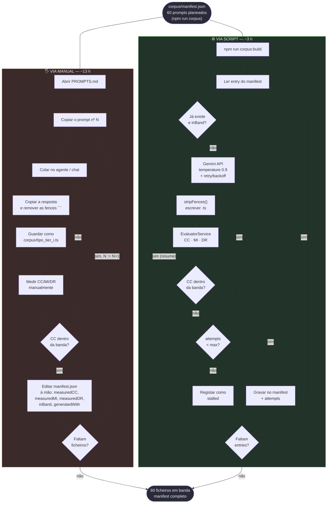
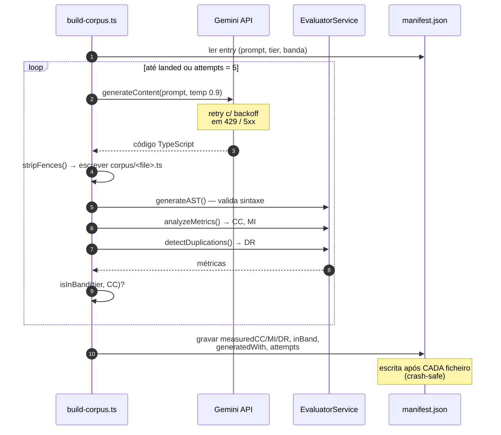
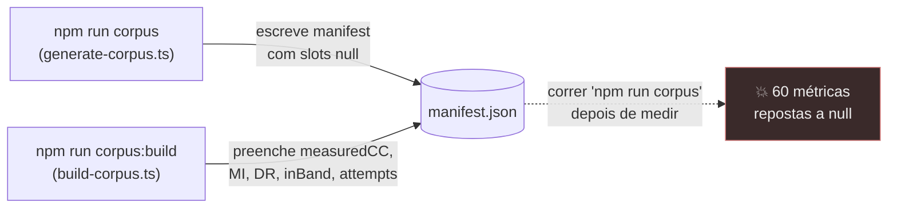

# Fluxo de materialização do corpus — Manual vs. Script

> **Onde isto encaixa** (numeração de `../docs/07-experimento.md`):
>
> | Fase | O quê | Ferramenta |
> | --- | --- | --- |
> | **1a** | Desenho: 60 prompts + manifest vazio | `npm run corpus` |
> | **1b** | **Materializar + medir + regerar** ← este documento | `npm run corpus:build` |
> | **2** | Mitigação: self-healing loop (Producer + Feedback) | run oficial sobre `corpus-run/` |
> | **3** | Análise estatística | `npm run stats` |
>
> A fase 1b **gera e mede**; nunca mitiga. Aplicar os critérios de qualidade do
> `FeedbackService` aqui refactorizaria o corpus no momento da geração e destruiria a
> condição Zero-Shot. O modo `--measure-only` faz uma passagem só de medição, sem API.

> Comparação dos dois caminhos para transformar os 60 prompts Zero-Shot em 60 ficheiros
> TypeScript medidos e dentro da banda de complexidade do respectivo tier.
>
> Relacionado: `../docs/07-experimento.md`

> ⚠️ **Cuidado com o termo "via manual" — significa duas coisas diferentes no projecto:**
>
> 1. **Neste documento:** gerar os **60 ficheiros do corpus** à mão (colar prompts num chat)
>    em vez de por script. É uma questão de *método de produção* — o artefacto é o mesmo.
> 2. **No `PLANO-FINALIZACAO.md` (tarefas 3.7–3.9):** a **mini rede social**, uma aplicação
>    construída à mão como contraponto ao corpus. É um *artefacto diferente*, com outro papel
>    na tese (estudo de caso, e a única fonte de `duplicationRate` reportável).
>
> Este documento trata só do sentido 1.

---

## 1. Comparação lado a lado



**A diferença estrutural:** na via manual o humano *é* o loop — cada uma das ~10 caixas
repete-se 60 vezes, e o ciclo de regeneração (M6 → M2) reinicia o trabalho manual todo.
Na via script o humano lança o processo uma vez e o loop corre sozinho, incluindo a
regeneração dos fora-de-banda.

---

## 2. O que o script faz por ficheiro



---

## 3. Custo comparado

| | 🖐️ Manual | ⚙️ Script |
| --- | --- | --- |
| Escrever a ferramenta | — | ~1 h (feito) |
| Gerar os 60 ficheiros | ~8 h | ~10 min |
| Regenerar os fora-de-banda | ~3 h | automático |
| Medir e preencher o manifest | ~2 h | automático |
| **Total** | **~13 h** | **~3 h** |
| Custo em API | 0 € (usa a subscrição do chat) | ~1 USD |
| Retomar após falha | do zero, na cabeça | `--resume` implícito, salta os em banda |

---

## 4. Diferenças que importam para a tese

| Dimensão | 🖐️ Manual | ⚙️ Script |
| --- | --- | --- |
| **Condição Zero-Shot** | Preservada | Preservada — está no *conteúdo* do prompt, não no canal |
| **Reprodutibilidade** | Sessões de chat não registadas; ninguém consegue repetir | Prompt + modelo + temperatura + tentativas, tudo no manifest |
| **Instrumento de medição** | Risco de divergir do pipeline | O **mesmo** `EvaluatorService` que o Producer usa |
| **Nº de tentativas por ficheiro** | Perde-se | Gravado em `attempts` — resposta pronta ao júri sobre a selecção |
| **Modelo usado** | Fácil de trocar a meio sem dar por isso | Fixo e registado em `generatedWith` |
| **Validade externa** | ✅ Reproduz o gesto real do programador (agente/IDE) | ⚠️ Canal API, não o IDE |

**A única vantagem real do manual é a última linha.** Se a tese defende que o corpus
representa código como os programadores o produzem no dia-a-dia (num agente dentro do IDE),
há aí um argumento de validade externa. Nesse caso a saída honesta é gerar uma **amostra**
pela via manual, comparar as métricas com as da via script, e documentar a equivalência.

---

## 5. Guard contra perda de dados

Os dois scripts escrevem no mesmo `manifest.json`, o que cria um risco:



**Mitigado:** o `generate-corpus.ts` passou a recusar sobrescrever um manifest que já tenha
métricas medidas, a menos que se passe `--force`.

```
❌ Refusing to overwrite manifest.json: it already holds 60 measured file(s).
   Rewriting it would reset every measuredCC/MI/DR to null.
   Pass --force if you really mean to discard the measurements.
```

---

## 6. Comandos

```bash
npm run corpus                            # Fase 0 — desenho: 60 prompts + manifest vazio
npm run corpus:build                      # Fase 1+2 — gerar + medir + regerar o que falta
npm run corpus:build -- --only=high       # só os ficheiros do tier high
npm run corpus:build -- --measure-only    # sem chamadas à API; só re-medir o que existe
npm run corpus:build -- --force           # regerar mesmo os que já estão em banda
npm run corpus:build -- --max-attempts=8  # insistir mais nos domínios resistentes
```

> ⚠️ Depois do corpus fechado: **`cp -r corpus/ corpus-run/`** antes de correr o pipeline.
> O Producer escreve o código refatorado por cima do original e apaga o `.bak` quando
> converge — correr sobre `corpus/` destrói o corpus.
