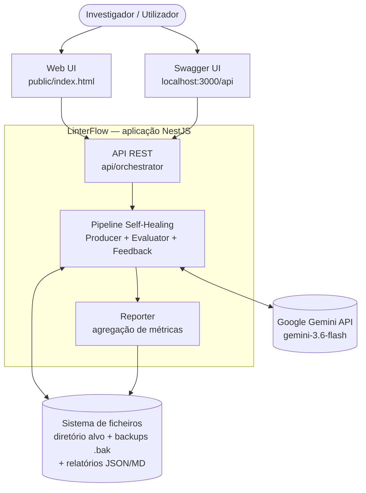

# 01 — Visão Geral

## O problema

Código gerado por LLMs em modo Zero-Shot (sem restrições de qualidade no prompt) tende a carregar dívida técnica estrutural: funções longas com condicionais aninhadas, baixa manutenibilidade e duplicação de lógica. A dissertação investiga se um ciclo automático de análise estática + refactoring por LLM consegue mitigar essa dívida de forma mensurável e estatisticamente significativa.

## A solução

O **LinterFlow** é uma aplicação NestJS que implementa um *self-healing loop*: cada ficheiro TypeScript é analisado por um motor de análise estática, comparado contra limiares de qualidade da literatura, e — quando falha — reescrito pelo Gemini com um prompt de refactoring direcionado ao problema detetado. O ciclo repete até convergir ou esgotar o orçamento de iterações. O ficheiro original está sempre protegido por backup e é restaurado se o loop não convergir.

```
Controller → Producer → Evaluator → Feedback → Gemini API → (loop) → Reporter
```

## Diagrama de contexto (C4 — Nível 1)



## Atores e sistemas externos

| Ator / Sistema | Papel |
| --- | --- |
| Investigador | Dispara a orquestração via UI, Swagger ou `curl`; consome os relatórios exportados |
| Google Gemini API | LLM que executa o refactoring; modelo configurável via `GEMINI_MODEL` (default `gemini-3.6-flash`) |
| Sistema de ficheiros | Fonte dos ficheiros `.ts` a analisar, destino dos backups `.bak` e dos relatórios `linterflow-report-*.json/.md` |

## Stack tecnológica

| Camada | Tecnologia | Uso |
| --- | --- | --- |
| Framework | NestJS 11 (Express) | Injeção de dependências, módulos, API REST |
| Parsing | `@babel/parser` | Validação de AST (plugins: `typescript`, `decorators-legacy`, `jsx`) |
| Métricas | `typhonjs-escomplex` | Complexidade Ciclomática + Índice de Manutenibilidade |
| Duplicação | `jscpd` (`detectClones` programático) | Deteção de clones, `minLines: 5`, `minTokens: 50` |
| LLM | `@google/genai` | Chamadas ao Gemini para refactoring |
| Validação | `class-validator` + `ValidationPipe` global | Validação de DTOs com whitelist estrita |
| Docs API | `@nestjs/swagger` | OpenAPI interativo em `/api` |
| Testes | Jest + ts-jest | Testes unitários por módulo (`*.spec.ts`) |
| Estatística | Python (`scipy`, `numpy`) | Wilcoxon Signed-Rank + Cliff's Delta |

## Estrutura do repositório

```
linterflow-app/
├── src/
│   ├── core/types.ts            # Contratos partilhados (AnalysisReport, FileMetrics, ...)
│   ├── producer/                # Orquestração + API REST + self-healing loop
│   ├── evaluator/               # Análise estática: AST, CC/MI, duplicações
│   ├── feedback/                # Limiares + geração de prompts de refactoring
│   ├── reporter/                # Métricas pré/pós, deltas, export JSON/Markdown
│   ├── app.module.ts            # Módulo raiz (regista todos os módulos)
│   └── main.ts                  # Bootstrap: ValidationPipe, Swagger, static assets
├── scripts/
│   ├── generate-corpus.ts       # Gera os 60 prompts Zero-Shot do experimento
│   └── stats_analysis.py        # Wilcoxon + Cliff's Delta sobre o JSON do Reporter
├── corpus/                      # Prompts, manifest e ficheiros do experimento
├── mock-code/                   # Ficheiros de teste do pipeline
├── public/index.html            # Frontend (SPA servida pelo NestJS)
├── docs/                        # Esta documentação
└── test/                        # Testes e2e
```

## Limiares de qualidade (fundamentação)

| Métrica | Limiar | Fundamentação |
| --- | --- | --- |
| Complexidade Ciclomática | ≤ 10 | McCabe (1976) propôs 10 como limite acima do qual o risco de defeitos e o custo de teste crescem de forma acentuada |
| Índice de Manutenibilidade | ≥ 65 | Escala de Oman (1992); abaixo de 65 o código é considerado difícil de manter |
| Taxa de duplicação | ≤ 3% | Prática comum em gates de qualidade (ex.: SonarQube usa 3% como default) |
| Iterações máximas | 5 | Orçamento que equilibra custo de API e probabilidade de convergência |
