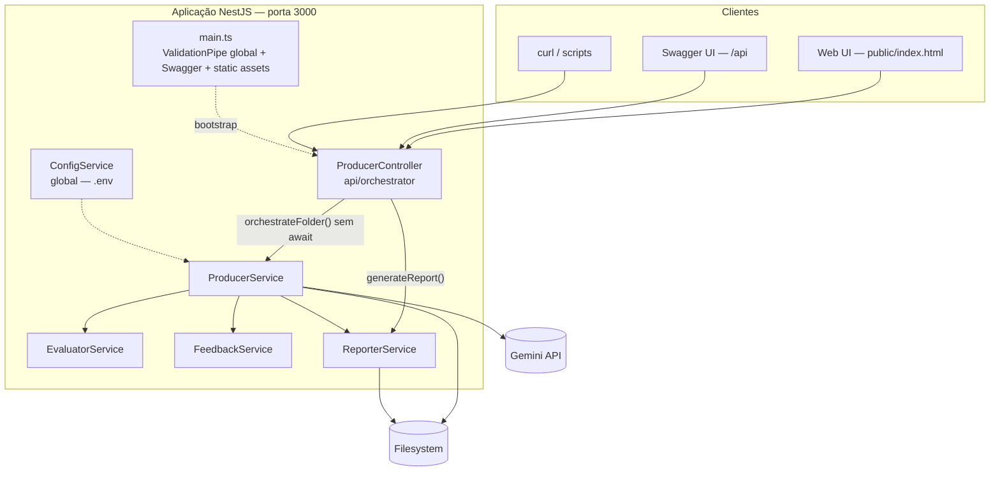
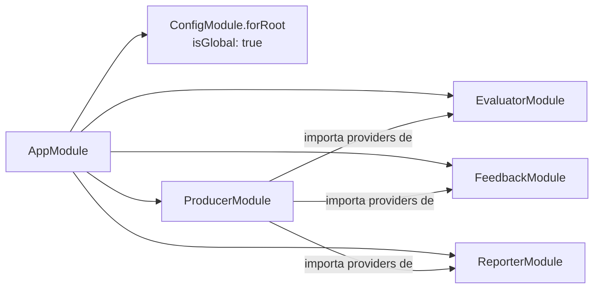
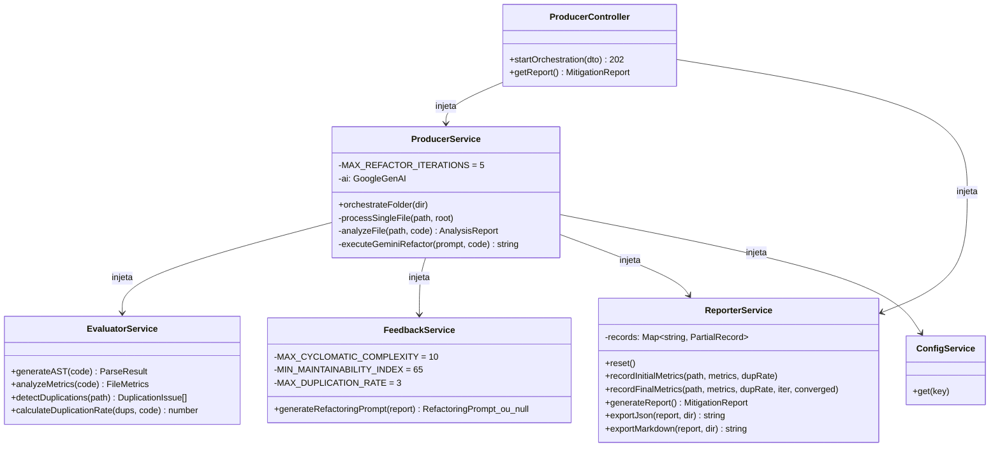

# 02 — Arquitetura

## Estilo arquitetural

O LinterFlow segue uma arquitetura modular NestJS com separação estrita de responsabilidades, inspirada no padrão **Producer–Evaluator–Reflector** de sistemas self-healing:

- **Producer** — orquestra o ciclo e aplica as mudanças (é o único módulo que escreve ficheiros de código e fala com o Gemini)
- **Evaluator** — mede (é puro: recebe código/paths, devolve métricas, nunca decide)
- **Feedback (Reflector)** — decide (compara métricas com limiares e produz o prompt; nunca mede nem escreve)
- **Reporter** — memoriza e agrega (estado pré/pós por ficheiro, deltas, exportação)

Esta separação garante que os limiares vivem num único sítio (Feedback), as medições noutro (Evaluator) e os efeitos secundários noutro (Producer), o que simplifica os testes unitários — cada módulo é mockável isoladamente.

## Diagrama de contentores (C4 — Nível 2)

## Grafo de módulos NestJS

O `AppModule` regista os quatro módulos de domínio. O `ConfigModule` é global (`isGlobal: true`), pelo que o `ConfigService` está disponível em qualquer provider sem import explícito.

## Dependências entre serviços (injeção de dependências)

## Responsabilidade de cada camada no ciclo

```mermaid
flowchart LR
    subgraph medir [Medir — Evaluator]
        m1[AST via Babel]
        m2[CC + MI via escomplex]
        m3[Clones via jscpd]
        m4[Taxa de duplicação %]
    end
    subgraph decidir [Decidir — Feedback]
        d1{CC > 10?}
        d2{MI < 65?}
        d3{DUP > 3%?}
        d4[Prompt + prioridade<br/>ou null]
    end
    subgraph agir [Agir — Producer]
        a1[Backup .bak]
        a2[Chamar Gemini]
        a3[Escrever ficheiro]
        a4[Restaurar/limpar]
    end
    subgraph registar [Registar — Reporter]
        r1[Snapshot inicial]
        r2[Snapshot final]
        r3[Deltas + stats globais]
        r4[JSON + Markdown]
    end

    medir --> decidir --> agir --> registar
```

## Propriedades de resiliência

| Mecanismo | Onde | Comportamento |
| --- | --- | --- |
| Backup antes do loop | `ProducerService.processSingleFile` | O original é copiado para `<ficheiro>.bak` antes de qualquer alteração |
| Restauro em não-convergência | idem | Ao atingir 5 iterações sem passar os limiares, o original é restaurado e o `.bak` removido |
| Restauro em erro fatal | idem (catch) | Qualquer exceção (parse, API, IO) restaura o original |
| Validação de AST por iteração | `evaluator.generateAST()` | Garante que o código devolvido pelo Gemini continua a parsear antes de prosseguir |
| Falha isolada de jscpd | `detectDuplications` (catch) | Devolve `[]` em vez de rebentar o pipeline |
| API não-bloqueante | `ProducerController` | O `orchestrateFolder()` corre sem `await`; o cliente recebe `202 Accepted` imediatamente |
| Whitelist de input | `main.ts` ValidationPipe | `whitelist + forbidNonWhitelisted`: propriedades extra no body são rejeitadas |
