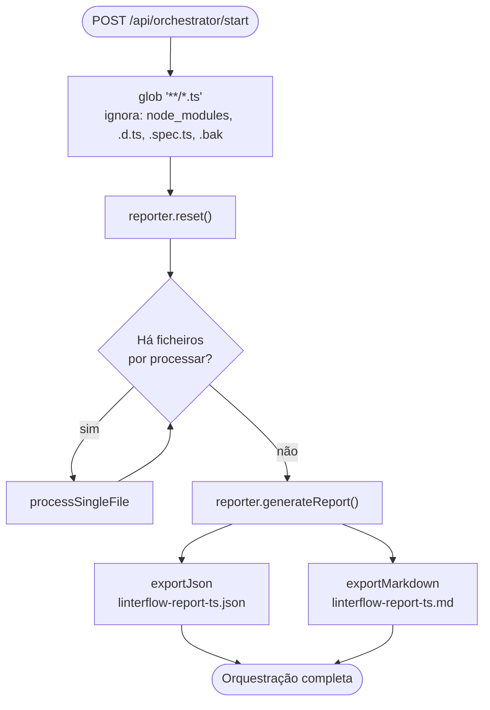
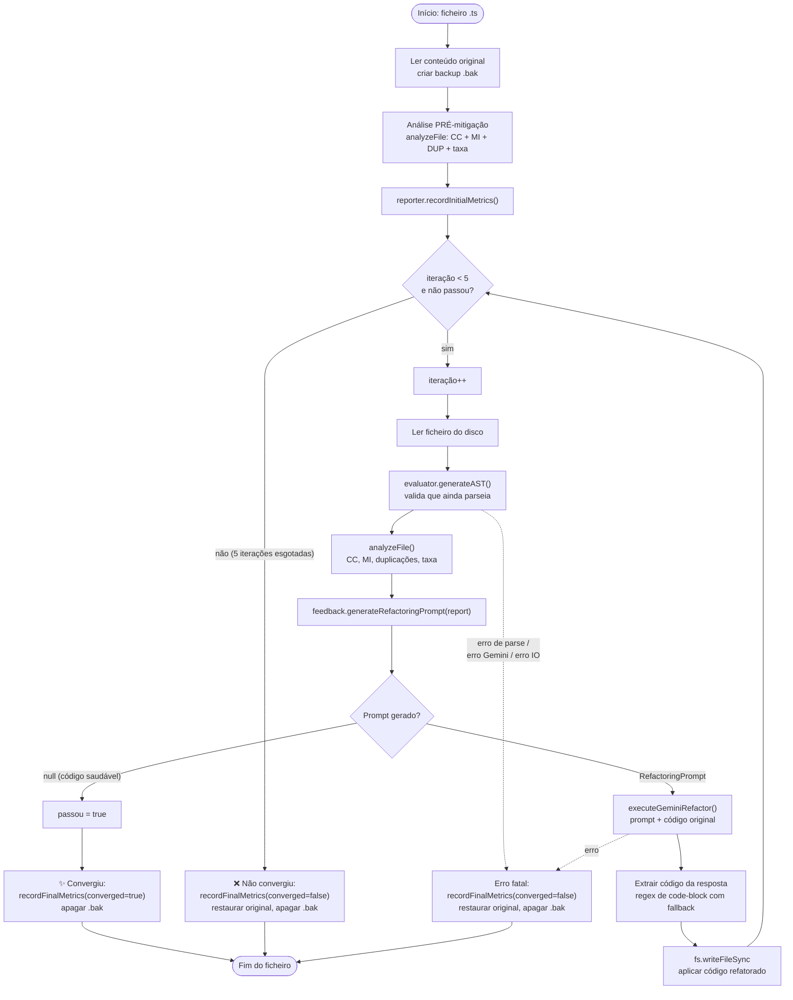
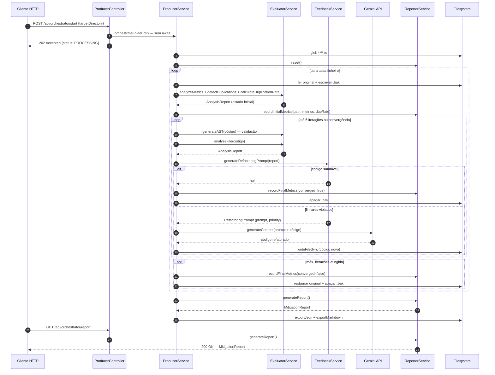
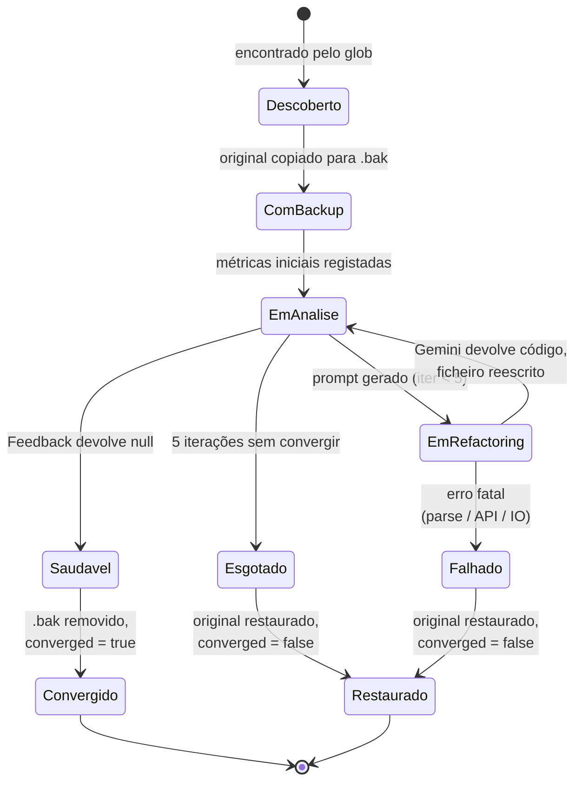
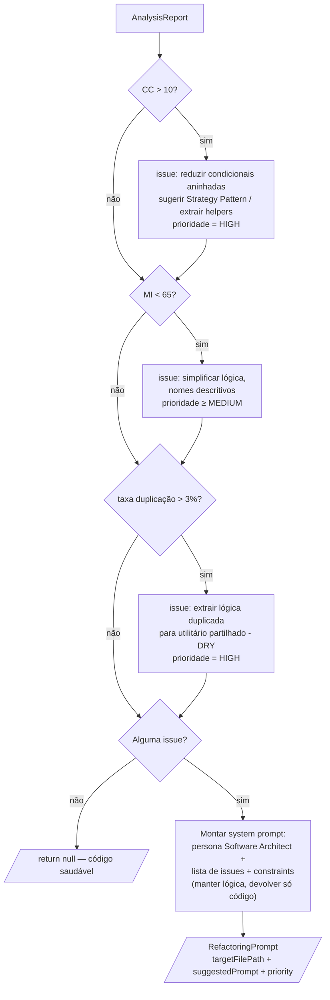

# 03 — Fluxo do Pipeline (Self-Healing Loop)

## Fluxograma completo — orquestração de uma pasta

`ProducerService.orchestrateFolder(targetDirectory)`:



## Fluxograma detalhado — self-healing loop por ficheiro

`ProducerService.processSingleFile(filePath, rootDir)`:



## Diagrama de sequência — uma iteração com refactoring



## Máquina de estados — ciclo de vida de um ficheiro



## Decisão do Feedback (Reflector)

Lógica de `FeedbackService.generateRefactoringPrompt`:



## Extração do código da resposta do Gemini

A resposta do LLM pode vir com ou sem fences de Markdown. A extração é feita em duas fases:

1. Regex `` /```(?:typescript|ts|javascript|js)?\n([\s\S]*?)```/ `` — captura o primeiro code-block e usa o seu conteúdo.
2. Fallback — se não houver code-block, remove todas as ocorrências de `` ```typescript `` e `` ``` `` e faz `trim()`.

O resultado é escrito diretamente no ficheiro; a validação acontece na iteração seguinte via `generateAST()` — se o Gemini devolver código que não parseia, o erro é apanhado e o original restaurado.
