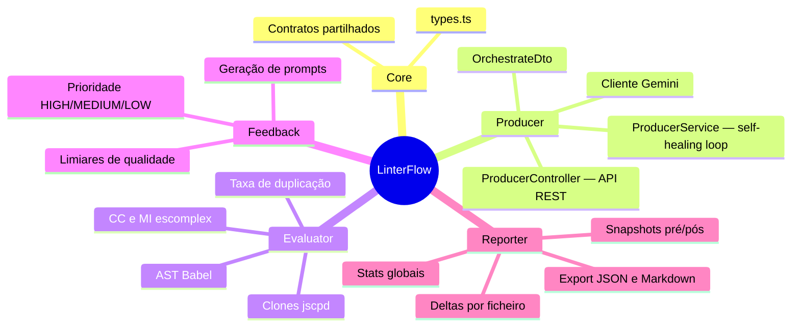
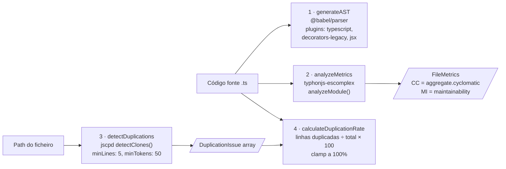
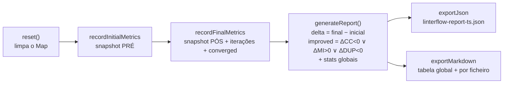

# 04 — Módulos

Cada módulo NestJS tem um `*.module.ts`, um `*.service.ts` e um `*.spec.ts`. Este documento descreve o contrato e o funcionamento interno de cada um.

## Mapa geral



---

## Core — `src/core/types.ts`

Contratos partilhados entre módulos. Não tem lógica; é o vocabulário comum do pipeline.

| Tipo | Papel |
| --- | --- |
| `AnalysisReport` | Saída do Evaluator: `filePath`, `metrics`, `duplications[]`, `duplicationRate` (0–100%) |
| `FileMetrics` | `cyclomaticComplexity` + `maintainabilityIndex` |
| `DuplicationIssue` | `lines` ("início-fim") + `fragment` (excerto duplicado) |
| `RefactoringPrompt` | Saída do Feedback: `targetFilePath`, `suggestedPrompt`, `priority` |

---

## Evaluator — `src/evaluator/evaluator.service.ts`

Motor de análise estática em três estágios, sem estado.

### Estágios



### Notas de implementação

- `typhonjs-escomplex` e `jscpd` são carregados via `require` (não named import) — o escomplex expõe o módulo de forma incompatível com ESM interop; usa-se `escomplexModule.default || escomplexModule`.
- `detectDuplications` recebe um **path** (ficheiro ou pasta) e corre o jscpd programaticamente com `silent: true` para não poluir os logs. Em caso de erro devolve `[]` — falha de deteção de clones não deve abortar o pipeline.
- `calculateDuplicationRate` soma o tamanho de cada fragmento (`end - start + 1`) e divide pelo total de linhas do ficheiro; o resultado é limitado a 100% para proteger contra clones sobrepostos contados em dobro.
- `generateAST` lança `Static analysis error: ...` se o código não parsear — é isto que protege o loop contra respostas inválidas do Gemini.

---

## Feedback (Reflector) — `src/feedback/feedback.service.ts`

Único sítio do sistema onde os limiares estão definidos:

```ts
MAX_CYCLOMATIC_COMPLEXITY = 10
MIN_MAINTAINABILITY_INDEX = 65
MAX_DUPLICATION_RATE = 3   // percentagem
```

### Regras e prioridades

| Verificação | Sugestão incluída no prompt | Efeito na prioridade |
| --- | --- | --- |
| `CC > 10` | Reduzir condicionais aninhadas; Strategy Pattern ou extração de helpers | `HIGH` |
| `MI < 65` | Simplificar lógica; nomes descritivos | sobe para `MEDIUM` (se ainda `LOW`) |
| `duplicationRate > 3%` | Extrair lógica duplicada para utilitário/base class (DRY) | `HIGH` |

Se nenhuma regra disparar, devolve `null` — sinal de convergência para o Producer.

O prompt final tem persona ("expert Software Architect"), a lista de issues detetadas com os valores medidos, e duas constraints: manter a lógica de negócio e devolver apenas código raw (sem Markdown).

**TODOs registados no código:** geração de prompts mais dinâmica com base no histórico de iterações; quebrar múltiplos problemas em prompts separados (abordagem incremental).

---

## Producer — `src/producer/`

### `ProducerService`

Orquestrador e único módulo com efeitos secundários (escrita de ficheiros, chamadas de rede).

Constantes e configuração:

| Item | Valor | Origem |
| --- | --- | --- |
| `MAX_REFACTOR_ITERATIONS` | 5 | constante da classe (alinhada com a dissertação) |
| `GEMINI_API_KEY` | obrigatória | `.env` — o construtor lança erro se faltar |
| `GEMINI_MODEL` | `gemini-3.6-flash` (default) | `.env` |

Responsabilidades por método:

| Método | Responsabilidade |
| --- | --- |
| `orchestrateFolder(dir)` | Scan glob, `reporter.reset()`, itera ficheiros, gera e exporta relatório final |
| `processSingleFile(path, root)` | Backup, métricas iniciais, loop de 5 iterações, registo final, restauro/limpeza |
| `analyzeFile(path, code)` | Junta as quatro medições do Evaluator num `AnalysisReport` — nota: o jscpd corre sobre o **ficheiro** em análise, não sobre a pasta raiz |
| `executeGeminiRefactor(prompt, code)` | Chamada ao Gemini + extração do code-block da resposta |

### `ProducerController`

Ver [05 — API REST](./05-api.md). Ponto essencial: `orchestrateFolder()` é disparado **sem `await`** com um `.catch()` para registar falhas de background — o pedido HTTP devolve `202` de imediato.

### `OrchestrateDto`

`targetDirectory: string` com `@IsString()` + `@IsNotEmpty()` e `@ApiProperty` para o Swagger. O `ValidationPipe` global (whitelist estrita) rejeita bodies com campos extra.

---

## Reporter — `src/reporter/reporter.service.ts`

Estado em memória (`Map<filePath, PartialRecord>`) que acumula snapshots e produz o relatório de mitigação.

### Ciclo de vida dos dados



### Semântica dos registos finais

| Cenário | O que é registado como estado final |
| --- | --- |
| Convergiu | Último `AnalysisReport` do loop (o código refatorado que está no disco) |
| Não convergiu (5 iterações) | Métricas **iniciais** — porque o original é restaurado, o estado final real é igual ao inicial |
| Erro fatal | Métricas iniciais, `converged = false` |

### Estatísticas globais (`GlobalStats`)

`totalFiles`, `filesConverged`, `filesNotConverged`, `filesImproved`, `avgIterations` e as médias dos deltas de CC, MI e taxa de duplicação. Os deltas são formatados com sinal explícito (`+3.20`, `-1.50`) no Markdown.

---

## Testes

| Ficheiro | Cobertura |
| --- | --- |
| `evaluator.service.spec.ts` | AST, CC/MI, jscpd |
| `feedback.service.spec.ts` | Relatório saudável (null), relatório high-priority |
| `producer.service.spec.ts` | Loop completo com `fs`, `glob` e Gemini mockados |
| `producer.controller.spec.ts` | Endpoint `start` (202, disparo assíncrono) |
| `reporter.service.spec.ts` | Registos, deltas e exportação |

Comandos: `npm run test`, `npm run test:cov` (relatório em `coverage/`), `npm run test:e2e`.
