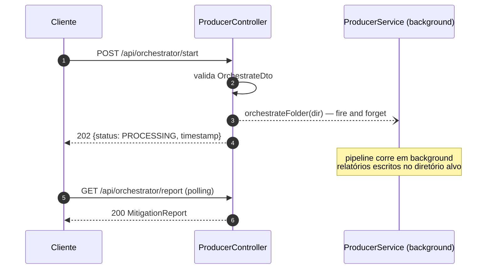

# 05 — API REST

Servida em `http://localhost:3000`. Documentação interativa OpenAPI (Swagger UI) em `http://localhost:3000/api`. A SPA (frontend em `public/index.html`) é servida como static asset pela mesma aplicação.

## Endpoints

| Método | Rota | Descrição | Resposta |
| --- | --- | --- | --- |
| `POST` | `/api/orchestrator/start` | Dispara o pipeline sobre um diretório (assíncrono) | `202 Accepted` |
| `GET` | `/api/orchestrator/report` | Devolve o relatório de mitigação da execução mais recente | `200 OK` |

---

## `POST /api/orchestrator/start`

### Request

```http
POST /api/orchestrator/start HTTP/1.1
Content-Type: application/json

{
  "targetDirectory": "./mock-code"
}
```

Validação (`OrchestrateDto` + `ValidationPipe` global):

| Regra | Comportamento |
| --- | --- |
| `targetDirectory` string não vazia | `400 Bad Request` se falhar |
| `whitelist: true` | Campos desconhecidos são removidos |
| `forbidNonWhitelisted: true` | Campos extra ⇒ `400 Bad Request` |

### Response — `202 Accepted`

```json
{
  "status": "PROCESSING",
  "message": "LinterFlow orchestration started successfully in the background.",
  "targetDirectory": "./mock-code",
  "timestamp": "2026-06-04T10:00:00.000Z"
}
```

### Porquê 202 e não 200/201

O processamento de uma pasta pode envolver dezenas de ficheiros × até 5 chamadas ao Gemini cada — minutos de trabalho. O controller dispara `orchestrateFolder()` **sem `await`** (com `.catch()` para logging de falhas de background) e responde imediatamente, evitando timeouts HTTP.



---

## `GET /api/orchestrator/report`

Devolve o `MitigationReport` acumulado em memória pelo `ReporterService` (a execução mais recente desde o arranque do servidor).

### Response — `200 OK`

```json
{
  "generatedAt": "2026-06-21T17:18:21.975Z",
  "globalStats": {
    "totalFiles": 1,
    "filesConverged": 1,
    "filesNotConverged": 0,
    "filesImproved": 1,
    "avgIterations": 2,
    "avgDeltaCyclomaticComplexity": -9,
    "avgDeltaMaintainabilityIndex": 14.3,
    "avgDeltaDuplicationRate": -4.1
  },
  "files": [
    {
      "filePath": "/.../mock-code/highComplexityFile.ts",
      "initial": { "cyclomaticComplexity": 18, "maintainabilityIndex": 52.1, "duplicationRate": 4.1 },
      "final":   { "cyclomaticComplexity": 9,  "maintainabilityIndex": 66.4, "duplicationRate": 0 },
      "delta":   { "cyclomaticComplexity": -9, "maintainabilityIndex": 14.3, "duplicationRate": -4.1 },
      "iterations": 2,
      "converged": true,
      "improved": true
    }
  ]
}
```

> Nota: se for chamado antes de qualquer execução (ou após restart), devolve um relatório vazio (`totalFiles: 0`) — o estado do Reporter vive em memória. Os relatórios persistidos ficam no diretório alvo como `linterflow-report-{timestamp}.json/.md`.

---

## Exemplos com curl

```bash
# Disparar o pipeline
curl -X POST http://localhost:3000/api/orchestrator/start \
  -H "Content-Type: application/json" \
  -d '{"targetDirectory": "./mock-code"}'

# Consultar o relatório
curl http://localhost:3000/api/orchestrator/report
```

## Configuração (`.env`)

| Variável | Obrigatória | Default | Descrição |
| --- | --- | --- | --- |
| `GEMINI_API_KEY` | ✅ (o arranque falha sem ela) | — | Chave da Google Gemini API |
| `GEMINI_MODEL` | não | `gemini-3.6-flash` | Modelo usado no refactoring |

## Códigos de erro

| Código | Causa |
| --- | --- |
| `400` | Body inválido: `targetDirectory` ausente/vazio ou campos extra |
| `404` | Rota inexistente |
| `500` | Erro inesperado no controller (erros do pipeline em background **não** afetam a resposta HTTP — são registados no logger) |
