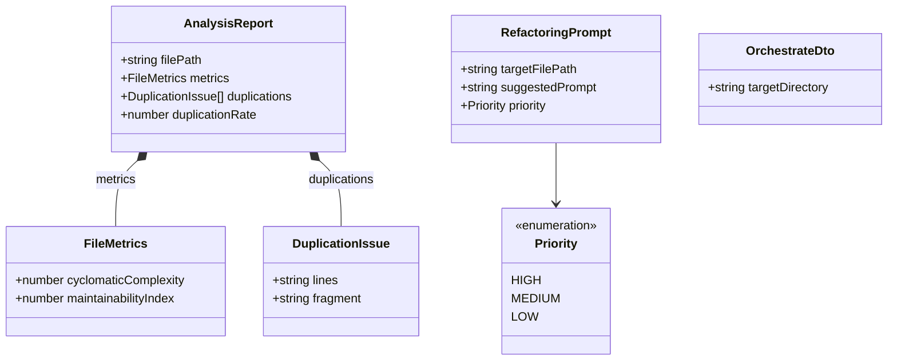
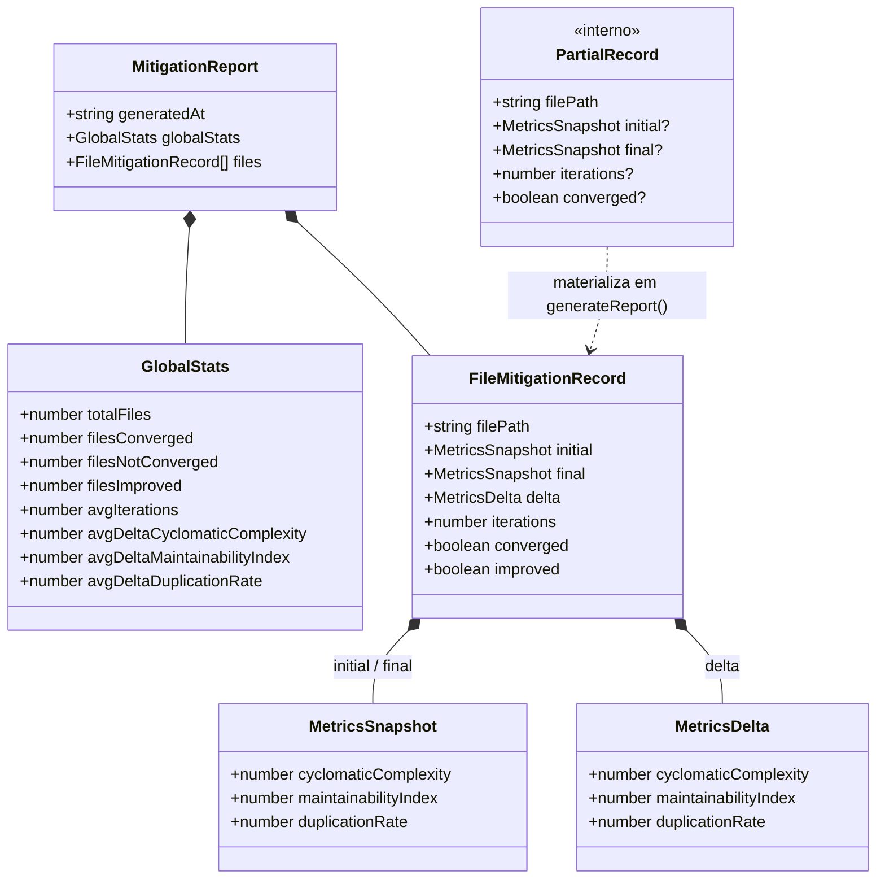
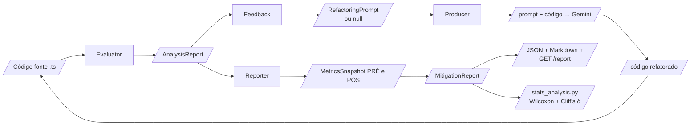

# 06 — Modelo de Dados

Dois grupos de tipos: os **contratos do pipeline** (`src/core/types.ts`, trocados entre Evaluator → Feedback → Producer) e os **tipos do relatório** (`src/reporter/reporter.service.ts`, usados na agregação e exportação).

## Diagrama de classes — contratos do pipeline

## Diagrama de classes — relatório de mitigação

## Fluxo dos dados através do pipeline

## Semânticas importantes

| Campo | Semântica |
| --- | --- |
| `duplicationRate` | Percentagem 0–100: `(Σ linhas dos fragmentos duplicados ÷ total de linhas) × 100`, com clamp a 100% |
| `delta.*` | Sempre `final − initial`. Melhoria = ΔCC < 0, ΔMI > 0, ΔDUP < 0 |
| `improved` | `true` se **qualquer** delta for na direção de melhoria |
| `converged` | `true` só se o Feedback devolveu `null` dentro do orçamento de 5 iterações |
| `final` quando não converge | Igual a `initial` — o ficheiro original é restaurado, logo o estado real em disco não mudou |
| `generatedAt` / nomes de ficheiro | ISO 8601; no nome do ficheiro `:` e `.` são substituídos por `-` (filesystem-safe) |

## Artefactos persistidos

| Artefacto | Localização | Produtor |
| --- | --- | --- |
| `linterflow-report-{ts}.json` | diretório alvo da orquestração | `ReporterService.exportJson` |
| `linterflow-report-{ts}.md` | diretório alvo da orquestração | `ReporterService.exportMarkdown` |
| `<ficheiro>.ts.bak` | ao lado do ficheiro (temporário, removido no fim) | `ProducerService` |
| `corpus/manifest.json` | plano do experimento + métricas medidas | `scripts/generate-corpus.ts` |
| `corpus/prompts/*.prompt.txt` | 60 prompts Zero-Shot | `scripts/generate-corpus.ts` |
