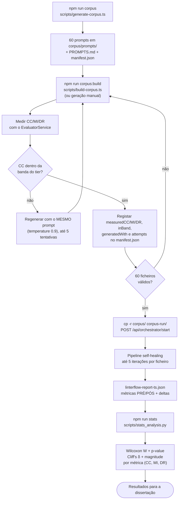

# 07 — Protocolo Experimental

Como o LinterFlow é usado para validar a hipótese da dissertação: *um ciclo automático de análise estática + LLM reduz de forma estatisticamente significativa a dívida técnica estrutural de código gerado por LLMs em modo Zero-Shot*.

## Desenho do experimento

Corpus fatorial: **5 tipos de componente NestJS × 3 tiers de Complexidade Ciclomática × 4 ficheiros = 60 ficheiros**.

| Dimensão | Valores |
| --- | --- |
| Tipo de componente | Controller, Service, Repository, Middleware, DTO/Validator |
| Tier de CC (banda pretendida) | Low (CC ≤ 5), Medium (5 < CC ≤ 10), High (CC > 10) |
| Réplicas por célula | 4 (domínios de negócio distintos, para evitar quase-duplicados) |

A complexidade é uma **variável de desenho induzida pelo domínio**: prompts de tier alto descrevem domínios com muitas regras de negócio interdependentes (ex.: motor de aprovação de crédito), não pedem complexidade explicitamente. Nenhum prompt menciona qualidade, métricas, clean code ou design patterns — isso quebraria a condição Zero-Shot.

## Fluxo completo do experimento



## Fase 1a — Desenho do corpus (`scripts/generate-corpus.ts`)

O script **não chama nenhuma API**: produz apenas os artefactos de planeamento.

| Artefacto | Conteúdo |
| --- | --- |
| `corpus/prompts/{tipo}_{tier}_{i}.prompt.txt` | Um prompt Zero-Shot por ficheiro do corpus |
| `corpus/PROMPTS.md` | Os 60 prompts + os dois workflows de materialização |
| `corpus/manifest.json` | Plano completo com slots para `measuredCC/MI/DR`, `inBand`, `generatedWith`, `attempts` |

Estrutura de cada prompt: especificação do componente NestJS + domínio de negócio + diretiva de âmbito do tier + exigência de ficheiro único TypeScript válido + "devolver apenas código raw".

> **Guard:** o script recusa-se a sobrescrever um `manifest.json` que já contenha métricas medidas — reescrevê-lo reporia os 60 slots a `null`. Usar `--force` para forçar.

## Fase 1b — Materialização e medição (`scripts/build-corpus.ts`)

Transforma os 60 prompts em 60 ficheiros `.ts` medidos e dentro da banda. Duas vias produzem o mesmo artefacto:

| | Via automatizada (recomendada) | Via manual |
| --- | --- | --- |
| Comando | `npm run corpus:build` | Colar cada prompt de `PROMPTS.md` num agente |
| Esforço | ~3 h (inclui escrever a ferramenta) | ~13 h |
| Custo de API | ~1 USD | 0 (usa a subscrição do chat) |
| Reprodutibilidade | Prompt, modelo, temperatura e nº de tentativas registados | Sessões de chat não registadas |
| Validade externa | Canal API | Reproduz o gesto real do programador no IDE |

**A condição Zero-Shot é preservada nas duas.** Ela reside no *conteúdo* do prompt — que nunca menciona qualidade, métricas, clean code ou design patterns — e não no canal por onde o prompt é enviado.

O que o `build-corpus.ts` faz por ficheiro:

1. **Gera** — envia o prompt ao Gemini com `temperature = 0.9` e grava `corpus/<ficheiro>.ts`
2. **Mede** — usa o **mesmo `EvaluatorService`** que o pipeline usa, para que o snapshot "pré" do manifest e o "pré" do Reporter sejam comparáveis
3. **Regenera** — se o CC medido cair fora da banda, repete com o **mesmo prompt**, até 5 tentativas

Nunca mitiga: não há `FeedbackService` nem `ProducerService` nesta fase. Aplicar critérios de qualidade aqui refactorizaria o corpus no momento da geração e destruiria a variável dependente.

**Detalhes que sustentam a validade:**

- A **temperatura tem de ser > 0**. A `0` uma regeneração devolveria o ficheiro idêntico e o ciclo nunca terminaria; é a não-determinismo do modelo que produz a variante seguinte.
- O **prompt nunca é editado** entre tentativas. Alterá-lo para obter o CC desejado seria dirigir o conteúdo e quebraria a condição Zero-Shot.
- O **número de tentativas fica registado** em `attempts`, por ficheiro. Regenerar até cair em banda é uma forma de selecção; registar a contagem é o que a torna defensável.
- Ficheiros que **nunca** entram em banda são reportados como `stalled` no fim, em vez de incluídos em silêncio.
- O manifest é gravado **após cada ficheiro**: uma falha ou um rate limit custa, no máximo, o ficheiro em curso.

**Verificação de tier:** se o CC medido cair fora da banda pretendida, o ficheiro é descartado e regenerado com o mesmo prompt até cair na banda. Isto garante que o fator "tier" do desenho fatorial corresponde à realidade medida, e não apenas à intenção do prompt.

Modos de execução:

```bash
npm run corpus:build                      # gera tudo o que falta (resume: salta o que já está em banda)
npm run corpus:build -- --only=high       # só os ficheiros cujo nome contém "high"
npm run corpus:build -- --measure-only    # sem chamadas à API; só re-mede o que está em disco
npm run corpus:build -- --force           # regenera mesmo o que já está em banda
npm run corpus:build -- --max-attempts=8  # insiste mais nos domínios resistentes
```

> `--measure-only` é também a via para medir corpora gerados à mão — é o modo usado para a mini rede social construída manualmente.

## Fase 2 — Mitigação (pipeline LinterFlow)

O pipeline corre sobre uma **cópia** do corpus como qualquer outra pasta. Para cada ficheiro, o Reporter regista o snapshot pré-mitigação e o pós-mitigação (ver [03 — Fluxo](./03-fluxo-pipeline.md)). O output relevante para a análise é o `linterflow-report-{ts}.json`.

> ⚠️ **Correr sempre sobre uma cópia:** `cp -r corpus/ corpus-run/`. O Producer escreve o código refactorizado por cima do ficheiro original e apaga o `.bak` quando converge — apontar o pipeline a `corpus/` destrói o corpus.
>
> E **nunca duas vezes sobre a mesma pasta**: na segunda execução o snapshot "pré" seria código já refactorizado. Para repetir, apagar e recopiar a partir de `corpus/`.

## Fase 3 — Análise estatística (`scripts/stats_analysis.py`)

Testes emparelhados (pré vs. pós, por ficheiro), α = 0.05:

| Teste | O que mede | Justificação |
| --- | --- | --- |
| **Wilcoxon Signed-Rank** | Significância da diferença pré/pós | Não-paramétrico e emparelhado — métricas de código não seguem distribuição normal |
| **Cliff's Delta** | Tamanho do efeito | Não-paramétrico; interpretável mesmo com amostras pequenas |

Interpretação de |δ| (Romano et al., 2006): < 0.147 negligible · < 0.33 small · < 0.474 medium · ≥ 0.474 large.

Direções de melhoria: CC ↓, MI ↑, DR ↓. O script imprime, por métrica: n, médias pré/pós, delta médio, W, p-value, δ com magnitude e um veredicto (`improvement` / `significant but worse` / `no significant change`).

Métricas testadas, por ordem: violações de CC (variável dependente primária), max CC por função, CC total, **pontos de decisão**, MI e taxa de duplicação. Relatórios anteriores à introdução de alguma chave saltam esse teste em vez de rebentar.

**Pontos de decisão** é uma métrica **derivada**, calculada no script e não medida pelo Evaluator:

```
pontos de decisão = totalCyclomaticComplexity − functionCount
```

McCabe define v(G) = e − n + 2p, portanto num módulo de *p* funções cada função custa 1 antes de ramificar. Extrair um bloco de uma função para outra soma +1 ao total **por construção**, mesmo sem criar ramificação nenhuma — o CC total não distingue "mais ramificação" de "a mesma ramificação, em mais funções". Subtrair `functionCount` cancela esse termo e deixa a ramificação. É calculada aqui, e não no `ReporterService`, porque é uma *leitura* dos dados e não uma nova medição: o relatório continua a ser o registo do que foi observado, e o script o registo de como foi interpretado.

O bloco `DECOMPOSITION BUDGET` no fim de cada secção contrapõe o custo estrutural da decomposição (+1 por função nova) à subida observada no total — a diferença é a redução estimada de pontos de decisão. Ver [10 — Resultados §3](./10-resultados.md#3-complexidade-total-sob-decomposiçãoredistribui-ramificação).

```bash
# usa o relatório mais recente no CWD, ou passa o path explicitamente
python3 scripts/stats_analysis.py linterflow-report-<timestamp>.json

# experimento do corpus: desagregação por tier
python3 scripts/stats_analysis.py corpus-run/linterflow-report-<ts>.json --manifest=corpus/manifest.json
```

**Cada execução grava o transcript** em `<report>-stats.txt`, ao lado do relatório analisado — os números da dissertação têm de ser rastreáveis a um ficheiro, não a um scrollback de terminal. `--out=` redirecciona; `--no-save` suprime.

Dependências: `pip install scipy numpy`.

> **Resultados obtidos:** [10 — Resultados](./10-resultados.md).

## Segundo corpus — mini rede social (via utilizador leigo)

Uma aplicação produzida como um **não-especialista** a produz: um pedido único em linguagem corrente, sem especificação, e o que o agente decidir construir. Desenhada por `scripts/generate-manual-corpus.ts` (`npm run corpus:manual`), que **não chama nenhuma API**.

O pedido, na íntegra (`manual-corpus/prompts/request.prompt.txt`):

```text
Build me a complete social network app.

People should be able to create an account, publish short posts, follow each other,
and comment on posts. Everyone gets a timeline with the posts from the people they follow.

Make it a working backend API in TypeScript using NestJS.
```

**Porque é vago de propósito.** A dissertação é sobre código gerado por LLM no desenvolvimento de aplicações web, e quem gera esse código normalmente **não escreve um caderno de encargos**: descreve a app numa frase e aceita o que vem. Um conjunto de prompts com dez regras numeradas por ficheiro mede outra coisa — um programador que já sabe o que quer.

**A única direcção técnica que o pedido carrega** é "TypeScript com NestJS". Um leigo verdadeiro não diria isso, mas o Evaluator analisa TypeScript e o corpus com que se compara é NestJS — noutra stack não haveria medição nenhuma. É uma restrição declarada do instrumento, não um lapso.

**O que isto custa.** O conjunto de ficheiros passa a ser **resultado, não desenho**: não há grelha para preencher, não há equilíbrio por célula, e uma segunda execução do mesmo pedido produziria outra aplicação. Em troca compra as duas coisas que os 60 ficheiros não dão — validade externa, e duplicação com onde existir (os 60 têm um domínio distinto cada um e medem 0,841% ao nível do projecto, a maioria disso *dentro* de ficheiros individuais).

| | Corpus de 60 | Esta aplicação |
| --- | --- | --- |
| Papel | Quantitativo, inferencial | Estudo de caso, descritivo |
| n | 60 pares de ficheiros | 1 aplicação |
| Testes | Wilcoxon + Cliff's δ | Descritivo; comparado com o agregado |
| Conjunto de ficheiros | Desenhado (5×3×4) | **Resultado** — o que o agente construiu |
| Reproduzível | Sim, a partir do manifest | **Não** — outra execução constrói outra coisa |

**Os dois corpora nunca entram no mesmo teste estatístico.**

**Protocolo:**

1. Sessão **nova** de agente, numa pasta vazia **fora deste repositório** (uma pasta nova aqui dentro seria compilada pelo `tsc` e partiria o `npm run build`)
2. Colar o pedido. Mais nada.
3. Se o agente pedir esclarecimentos — e pedem quase sempre — responder **exactamente**: `You decide, whatever you think is best. I don't know the technical details.`
4. Deixar construir até dizer que acabou. Não pedir funcionalidades que não incluiu, não reportar bugs, não pedir alterações.
5. Copiar os `.ts` para `manual-corpus/`, sem modificações
6. `npm run corpus:manual -- --inventory` regista o que foi construído em `inventory.json`
7. Preencher `generatedWith`, `generatedAt` e `notes` à mão

A resposta fixa do passo 3 é o que torna o protocolo reproduzível: sem ela, cada esclarecimento vira uma decisão de especificação não documentada, e o caso volta a ser o do programador que sabe o que quer.

> ⚠️ **Não deixar o agente rever ficheiros que já escreveu.** Se ele voltar atrás para "arrumar" ou "melhorar" código anterior, parar. Isso é mitigação aplicada **antes** do tratamento e destrói o snapshot pré-mitigação em que o experimento assenta. Criar um ficheiro novo que importa um anterior é aceitável; reescrever o anterior não é.

> **Condição Zero-Shot.** O pedido não menciona qualidade, métricas, complexidade, padrões, duplicação nem reutilização. `assertZeroShot()` verifica isto antes de escrever seja o que for. E não se orienta o agente sobre repetição em nenhuma direcção: dizer-lhe para não se repetir apagaria a duplicação que este corpus existe para medir; dizer-lhe para se repetir fabricá-la-ia.

> ⚠️ **Nunca apontar o pipeline a `manual-corpus/`.** Copiar primeiro: `cp -r manual-corpus/ manual-run/`.

## Medição de duplicação ao nível do projecto (`scripts/project-duplication.ts`)

O pipeline mede duplicação **por ficheiro**: o `analyzeFile()` chama `detectDuplications(filePath)` com um único caminho, portanto o jscpd nunca compara um ficheiro com outro. É o comportamento correcto para o gate — atribuir um clone de pasta a um ficheiro individual falsearia o delta pré/pós desse ficheiro (bug #4) — mas deixa a repetição **entre módulos** por medir.

Este script mede-a, **sem tocar no pipeline**. Corre o jscpd sobre a pasta inteira, com os mesmos limiares (`minLines: 5`, `minTokens: 50`, constantes partilhadas em [`src/core/pipeline-files.ts`](../src/core/pipeline-files.ts)), e grava o resultado em JSON.

```bash
npm run dup -- manual-corpus                          # uma pasta
npm run dup -- --before=manual-corpus --after=manual-run   # pré vs pós
npm run dup -- corpus --top=20 --out=dup.json
```

Também disponível **na interface web** (tab *Duplication*) e em `POST /api/duplication/measure`. A medição vive no `DuplicationService` ([`src/duplication/`](../src/duplication/)) e o script é um invólucro fino sobre ele, para que CLI e UI nunca divirjam nos números da mesma pasta. É síncrono e **não é cobrado**: não faz chamadas ao modelo, e cobrar uma medição só de leitura desencorajaria tirar o snapshot "antes" — o único que não se recupera depois de o pipeline reescrever o código.

O módulo é separado do `EvaluatorModule` de propósito: o Evaluator é o instrumento com que os resultados do corpus já commitados foram produzidos, e não lhe tocar é o que os mantém comparáveis com o código que os produziu.

Devolve: ficheiros analisados, linhas totais, pares de clones, linhas duplicadas, taxa do projecto, os pares de ficheiros que mais se repetem e os ficheiros com mais linhas duplicadas.

**A taxa do projecto não é a taxa por ficheiro.** A do projecto atribui os **dois** lados de cada par ao respectivo ficheiro e mantém um *conjunto* de linhas duplicadas (uma linha em cinco clones conta uma vez, e a taxa é limitada a 100% por construção). A por ficheiro soma os fragmentos só do lado A e precisa de *clamp*. Não as reportar lado a lado como se fossem a mesma medição.

> ⚠️ **O que o script não demonstra.** O pipeline nunca tenta corrigir duplicação entre ficheiros, porque não a vê. Uma descida entre "antes" e "depois" é **efeito colateral** do refactoring de CC/MI, não prova de que o loop mitigou duplicação.

## Ameaças à validade consideradas no desenho

| Ameaça | Mitigação no desenho |
| --- | --- |
| Prompts induzirem qualidade (quebra do Zero-Shot) | Prompts nunca mencionam métricas/qualidade; complexidade induzida só pelo domínio |
| Quase-duplicados dentro de uma célula | 4 domínios de negócio distintos por célula (20 domínios por tier) |
| Ficheiros fora da banda de CC do tier | Verificação pós-geração + regeneração com o mesmo prompt |
| Não-convergência mascarar regressões | Ficheiros não convergidos são restaurados ao original ⇒ delta = 0, nunca negativo artificial |
| Distribuições não-normais | Testes não-paramétricos (Wilcoxon, Cliff's δ) |
