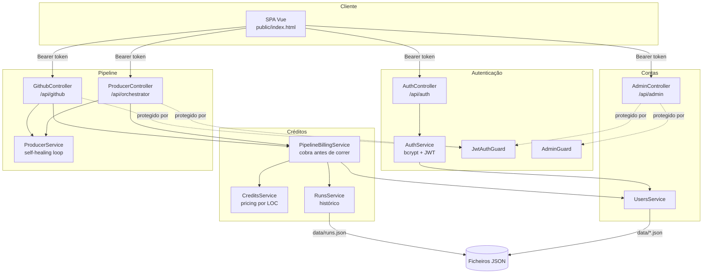
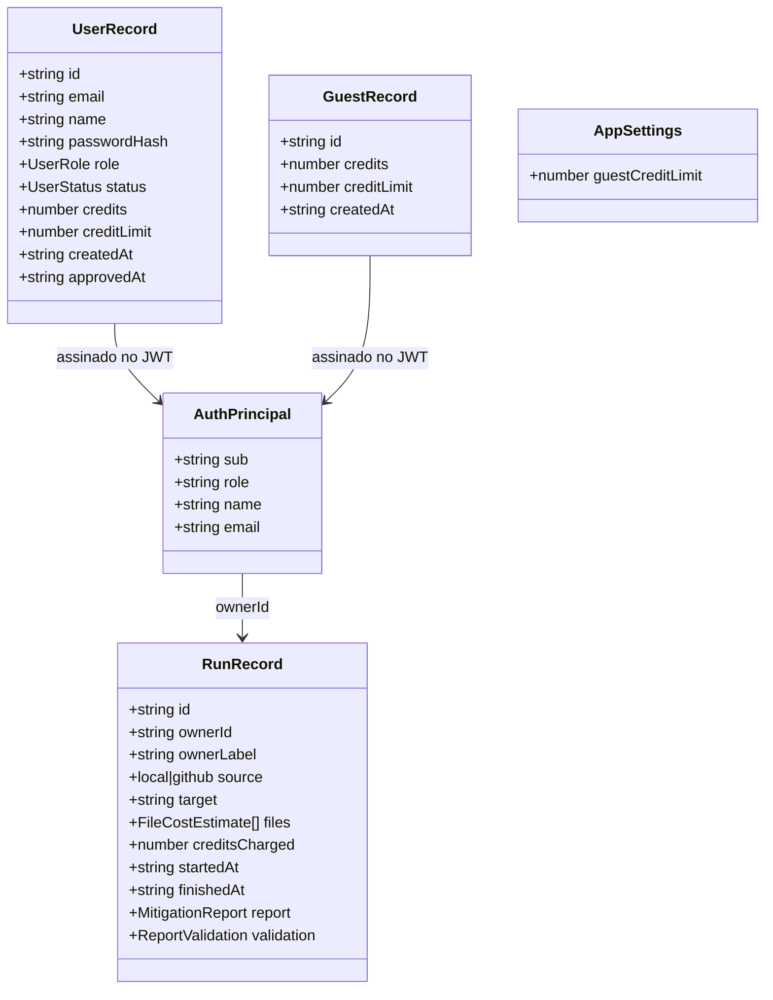
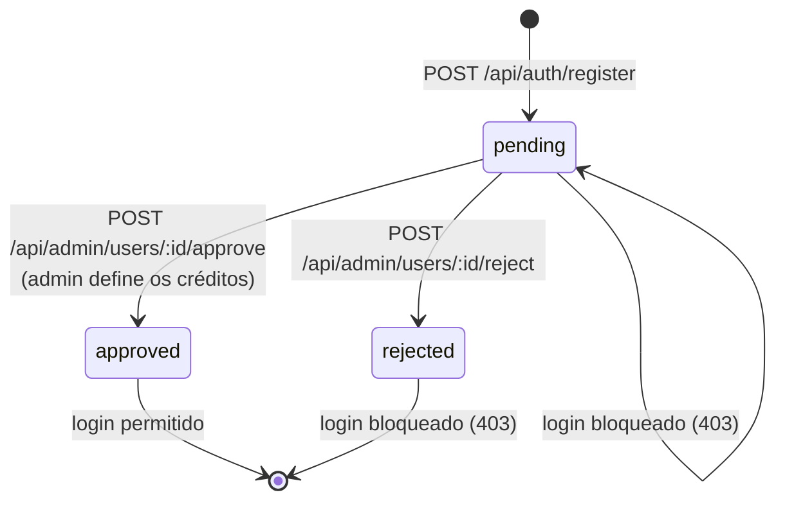
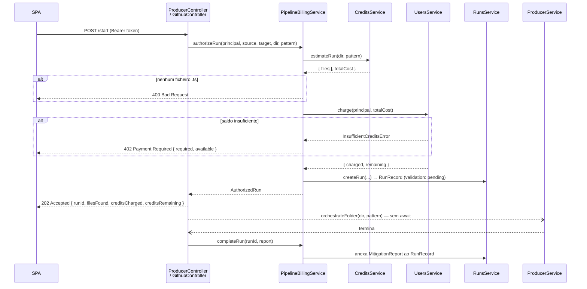

# 09 — Autenticação e Sistema de Créditos

Camada de contas que envolve o pipeline. Duas responsabilidades distintas, deliberadamente separadas em módulos diferentes:

- **Autenticação** (`src/auth`, `src/users`) — quem é o utilizador e o que pode fazer
- **Créditos** (`src/credits`, `src/runs`) — quanto custa uma execução e quem a pagou

A separação é o que torna possível desligar os créditos sem tocar na autenticação. A [secção 8](#8-remover-ou-desativar-o-sistema-de-créditos) detalha esse procedimento.

---

## 1. Visão geral



### Porquê persistência em ficheiro

`data/users.json`, `data/guests.json`, `data/settings.json` e `data/runs.json`. A aplicação corre como instância única durante o experimento da dissertação — uma base de dados acrescentaria custo de setup sem alterar a arquitetura em estudo. As escritas são síncronas (`fs.writeFileSync`), o que mantém cada ciclo read-modify-write atómico dentro do event loop do Node, sem interleaving.

> `data/` está no `.gitignore`. Um clone novo arranca sem contas e volta a semear o admin.

---

## 2. Modelo de domínio

Definido em [src/users/user.types.ts](../src/users/user.types.ts).



Campos opcionais no código (omitidos da notação acima): `UserRecord.approvedAt`, `AuthPrincipal.name`, `AuthPrincipal.email`, `RunRecord.finishedAt` e `RunRecord.report` — estes dois últimos só são preenchidos quando o pipeline termina.

| Tipo | Valores | Nota |
| --- | --- | --- |
| `UserRole` | `admin` \| `user` | O papel `guest` só existe no `AuthPrincipal`, nunca num `UserRecord` |
| `UserStatus` | `pending` \| `approved` \| `rejected` | Contas novas nascem `pending` |
| `PublicUser` | `Omit<UserRecord, 'passwordHash'>` | `toPublicUser()` garante que o hash nunca sai da API |

---

## 3. Autenticação

### 3.1 Fluxo de registo e aprovação

Registar **não** dá acesso. Um administrador tem de aprovar a conta e, no mesmo gesto, definir a dotação inicial de créditos.



O `AuthService.login()` distingue os três casos: credenciais erradas → `401`; conta `pending` → `403 "awaiting administrator approval"`; conta `rejected` → `403 "registration was rejected"`.

### 3.2 Sessão de convidado

`POST /api/auth/guest` cria um `GuestRecord` anónimo com a dotação definida em `settings.guestCreditLimit` (por omissão **3**) e devolve um JWT com `role: 'guest'`. Serve para experimentar o produto sem registo.

### 3.3 O token

[src/auth/auth.module.ts](../src/auth/auth.module.ts) regista o `JwtModule` com `global: true`, para que o `JwtService` seja injetável em qualquer módulo e o `JwtAuthGuard` possa ser aplicado sem reimportar o módulo.

| Parâmetro | Valor |
| --- | --- |
| Segredo | `JWT_SECRET` (fallback `'linterflow-dev-secret'`) |
| Validade | `24h` |
| Payload | `AuthPrincipal` — `{ sub, role, name?, email? }` |
| Hash de password | `bcryptjs`, custo 10 |

### 3.4 Guards

| Guard | Ficheiro | Comportamento |
| --- | --- | --- |
| `JwtAuthGuard` | [jwt-auth.guard.ts](../src/auth/guards/jwt-auth.guard.ts) | Exige `Authorization: Bearer <jwt>`, verifica a assinatura e coloca o payload em `request.user`. Aceita **todos** os papéis |
| `AdminGuard` | [admin.guard.ts](../src/auth/guards/admin.guard.ts) | Exige `request.user.role === 'admin'`. Tem de correr **depois** do `JwtAuthGuard`, que é quem popula `request.user` |

O decorator `@CurrentUser()` ([current-user.decorator.ts](../src/auth/decorators/current-user.decorator.ts)) injeta esse payload diretamente num parâmetro do handler.

### 3.5 Semeadura do administrador

`UsersService.onModuleInit()` cria a pasta `data/` e, se não existir nenhuma conta com `role: 'admin'`, semeia uma a partir de `ADMIN_EMAIL` / `ADMIN_PASSWORD`. Sem essas variáveis usa `admin@linterflow.local` / `admin-change-me` e emite um `Logger.warn` no arranque — é esse aviso que aparece nos testes e no `npm run start:dev`.

---

## 4. Sistema de créditos

### 4.0 Variáveis de ambiente

| Variável | Omissão | Efeito |
| --- | --- | --- |
| `JWT_SECRET` | `'linterflow-dev-secret'` | Segredo de assinatura dos tokens |
| `ADMIN_EMAIL` | `admin@linterflow.local` | Email do admin semeado no primeiro arranque |
| `ADMIN_PASSWORD` | `admin-change-me` | Password desse admin |
| `CREDITS_ENABLED` | ligado | `false` desativa toda a faturação — ver [secção 8](#nível-a--credits_enabledfalse-kill-switch-já-implementado) |

### 4.1 Tabela de preços

[src/credits/credits.service.ts](../src/credits/credits.service.ts). O custo depende do tamanho do ficheiro, medido em linhas não vazias (`countLoc`), para que reformatar código nunca altere o preço.

| Categoria | LOC | Custo |
| --- | --- | --- |
| `medium` | ≤ 300 | 1 crédito |
| `long` | 301 – 600 | 2 créditos |
| `very-long` | > 600 | 3 créditos |

Os limiares seguem a convenção dominante para comprimento de ficheiro: a regra `max-lines` do ESLint tem `300` por omissão, e a maioria dos guias de estilo assinala ficheiros acima de ~300–600 linhas como candidatos a divisão.

### 4.2 Estimativa

`estimateRun(directory, filePattern)` resolve **exatamente o mesmo conjunto de ficheiros** que o Producer vai processar — mesmo glob, mesma lista de exclusões:

```ts
const PIPELINE_IGNORE = ['**/node_modules/**', '**/*.d.ts', '**/*.spec.ts', '**/*.bak'];
```

> ⚠️ Esta constante duplica a lista de `ProducerService.orchestrateFolder()`. Se uma mudar, a outra tem de mudar também, sob pena de se cobrarem ficheiros que não são processados (ou vice-versa).

### 4.3 Cobrança

[src/credits/pipeline-billing.service.ts](../src/credits/pipeline-billing.service.ts) é o pré-voo partilhado pelos dois pontos de entrada do pipeline (caminho local e import do GitHub).



Duas decisões importantes:

- **Cobra-se antes de correr.** Uma execução nunca pode ultrapassar o saldo a meio do caminho. A consequência é que uma execução que falhe **não é reembolsada**.
- **Os admins nunca são cobrados.** `UsersService.charge()` devolve `{ charged: 0, remaining: null }` para `role === 'admin'`; o `null` é o que faz a UI mostrar "∞".

### 4.4 Histórico e validação

Cada execução gera um `RunRecord` que serve simultaneamente de histórico do utilizador (`GET /api/runs/mine`) e de fila de validação do administrador (`GET /api/admin/runs`). Quando o pipeline termina, o `MitigationReport` é anexado ao registo; o admin pode depois marcá-lo como `validated` ou `rejected` com notas.

---

## 5. Endpoints

### Públicos

| Método | Rota | Descrição |
| --- | --- | --- |
| `POST` | `/api/auth/register` | Cria conta em estado `pending`. Devolve `PENDING_APPROVAL` |
| `POST` | `/api/auth/login` | Email + password de conta aprovada → `{ token, user }` |
| `POST` | `/api/auth/guest` | Sessão anónima com a dotação de convidado |

### Autenticados (`JwtAuthGuard`)

| Método | Rota | Descrição |
| --- | --- | --- |
| `GET` | `/api/auth/me` | Perfil e saldo atualizados para o token |
| `GET` | `/api/runs/mine` | Histórico de execuções da conta, mais recentes primeiro |
| `POST` | `/api/orchestrator/start` | Cobra e arranca o pipeline sobre um caminho local |
| `GET` | `/api/orchestrator/report` | Último `MitigationReport` em memória |
| `POST` | `/api/github/import` | Importa um repositório público |
| `POST` | `/api/github/analyze` | Cobra e arranca o pipeline sobre o caminho selecionado |

### Administração (`JwtAuthGuard` + `AdminGuard`)

| Método | Rota | Descrição |
| --- | --- | --- |
| `GET` | `/api/admin/users` | Todas as contas com estado e créditos |
| `POST` | `/api/admin/users/:id/approve` | Aprova e concede `{ credits }` |
| `POST` | `/api/admin/users/:id/reject` | Rejeita o registo |
| `PATCH` | `/api/admin/users/:id/credits` | Redefine o saldo `{ credits }` |
| `GET` | `/api/admin/users/:id/history` | Histórico de uma conta específica |
| `GET` | `/api/admin/settings` | Definições atuais (limite de convidado) |
| `PATCH` | `/api/admin/settings` | Atualiza `{ guestCreditLimit }` |
| `GET` | `/api/admin/runs` | Todas as execuções de todas as contas |
| `POST` | `/api/admin/runs/:id/validate` | `{ decision: 'validated' \| 'rejected', notes? }` |

**Códigos de erro relevantes:** `401` token ausente/inválido · `402` créditos insuficientes (com `required` e `available` no corpo) · `403` conta por aprovar, rejeitada, ou acesso não-admin · `400` nenhum ficheiro `.ts` no alvo · `409` email já registado.

---

## 6. Frontend

Tudo em [public/index.html](../public/index.html) (SPA Vue 3 de ficheiro único).

| Peça | Localização aproximada | Função |
| --- | --- | --- |
| Ecrã de autenticação | `v-if="!session"`, linhas ~123–205 | Toggle login/registo + botão de convidado. Enquanto não há sessão, o resto da app não é renderizado |
| Barra de créditos | linhas ~87–111 | `{{ credits }} / {{ creditLimit }}`; `creditPercent` e `creditBarClass` (verde > 50%, amarelo > 20%, vermelho abaixo); admins veem "Unlimited credits" |
| `apiFetch()` | linha ~1100 | Wrapper do `fetch` que injeta `Authorization: Bearer` e faz logout automático em `401` |
| `restoreSession()` | linha ~1202 | No arranque, lê o token de `localStorage['linterflow_token']` e revalida-o em `GET /api/auth/me` |
| `applyCharge()` | linha ~1215 | Atualiza o saldo local com o `creditsRemaining` devolvido por `start`/`analyze` |
| Tab **History** | linhas ~667–720 | Consome `GET /api/runs/mine` |
| Tab **Admin Panel** | `v-if="isAdmin"`, linhas ~722–930 | Aprovações, gestão de créditos, limite de convidado, validação de relatórios |

---

## 7. Testes

| Ficheiro | Cobertura |
| --- | --- |
| [auth.service.spec.ts](../src/auth/auth.service.spec.ts) | Registo, login com credenciais erradas, bloqueio de contas `pending`/`rejected`, sessão de convidado |
| [users.service.spec.ts](../src/users/users.service.spec.ts) | Semeadura do admin, aprovação com dotação, cobrança, saldo insuficiente, convidados |
| [credits.service.spec.ts](../src/credits/credits.service.spec.ts) | Contagem de LOC, categorização, custo por categoria, estimativa de execução |
| [producer.controller.spec.ts](../src/producer/producer.controller.spec.ts) | Mocka `PipelineBillingService` e o `JwtAuthGuard`; verifica `authorizeRun`, propagação do `402` e `completeRun` |

---

## 8. Remover ou desativar o sistema de créditos

Três níveis, do mais reversível ao mais definitivo. **Os níveis A e B não tocam na autenticação** — o login, os papéis e o painel de administração continuam a funcionar.

### Nível A — `CREDITS_ENABLED=false` (kill switch já implementado)

**Não é preciso alterar código.** No `.env`:

```bash
CREDITS_ENABLED=false
```

Reiniciar a aplicação. O arranque confirma-o com um aviso:

```
WARN [UsersService] CREDITS_ENABLED=false — credit billing is disabled.
Runs are free and every account reports an unlimited balance.
```

O switch vive em [src/users/users.service.ts](../src/users/users.service.ts): o campo `creditsEnabled` é lido do `ConfigService` no constructor e curto-circuita os dois únicos métodos que mexem em saldos, exatamente pelo mesmo caminho que já servia os admins.

```ts
private readonly creditsEnabled: boolean;

constructor(private readonly configService: ConfigService) {
  this.creditsEnabled =
    this.configService.get<string>('CREDITS_ENABLED') !== 'false';
}

// charge()
if (!this.creditsEnabled || principal.role === 'admin') {
  return { charged: 0, remaining: null };
}

// getBalance()
if (!this.creditsEnabled || principal.role === 'admin') {
  return { credits: null, creditLimit: null, unlimited: true };
}
```

**Polaridade:** o valor por omissão é *ligado*. Só a string exata `"false"` desativa a faturação — uma variável ausente, mal escrita, `"0"` ou `"FALSE"` mantêm a cobrança ativa, para que um erro de configuração nunca torne o pipeline gratuito por acidente.

| Comportamento | `CREDITS_ENABLED=true` (ou ausente) | `CREDITS_ENABLED=false` |
| --- | --- | --- |
| `POST /api/orchestrator/start` | `creditsCharged: 1`, `creditsRemaining: 2` | `creditsCharged: 0`, `creditsRemaining: null` |
| `GET /api/auth/me` (convidado) | `credits: 3`, `unlimited: false` | `credits: null`, `unlimited: true` |
| Saldo insuficiente | `402 Payment Required` | nunca ocorre |
| Barra de créditos na UI | visível | substituída por "Unlimited credits" |
| Saldos em `data/users.json` | deduzidos | intactos |
| `RunRecord` / histórico | criado normalmente | criado normalmente, com `creditsCharged: 0` |

Como os saldos não são tocados enquanto o switch está ativo, voltar a `true` retoma exatamente onde se ficou. Contas, papéis, aprovações e o painel de administração continuam a funcionar em ambos os modos — o painel mantém os campos de crédito visíveis, que passam a não ter efeito prático.

Testes: `users.service.spec.ts` → `describe('CREDITS_ENABLED kill switch')`.

### Nível B — remover a cobrança dos controllers (mantém contas e histórico)

Se o objetivo for tirar o preço do caminho crítico do pipeline, os pontos de acoplamento são **apenas dois controllers**:

| Ficheiro | O que retirar |
| --- | --- |
| [src/producer/producer.controller.ts](../src/producer/producer.controller.ts) | Injeção de `PipelineBillingService`; a chamada `authorizeRun()`; o `.then(() => completeRun(...))`; os campos `runId`, `filesFound`, `creditsCharged`, `creditsRemaining` da resposta. O handler pode voltar a ser síncrono (deixa de haver `await`) |
| [src/github/github.controller.ts](../src/github/github.controller.ts) | O mesmo. Aqui o `ReporterService` só foi injetado para alimentar o `completeRun()` — sai também |
| [src/producer/producer.module.ts](../src/producer/producer.module.ts) · [src/github/github.module.ts](../src/github/github.module.ts) | Remover `CreditsModule` dos `imports` (e `ReporterModule` do `github.module`, se o ponto anterior for aplicado) |
| [src/producer/producer.controller.spec.ts](../src/producer/producer.controller.spec.ts) | Remover o mock de `PipelineBillingService` e as asserções sobre `authorizeRun` / `completeRun` (≈ linhas 40, 96, 140, 163, 179) |

Depois disto o pipeline volta a arrancar sem passar pela faturação, mas as rotas continuam protegidas por `JwtAuthGuard` e o histórico deixa de ser alimentado (nenhum `RunRecord` é criado).

### Nível C — remover o sistema por completo

Ordem sugerida, do interior para o exterior. **Atenção à dependência não óbvia:** `RunsService` importa o tipo `FileCostEstimate` de `credits.service.ts`, por isso o módulo `runs` não sobrevive intacto à eliminação de `src/credits/`.

1. Aplicar tudo o que está no **Nível B**.
2. Apagar `src/credits/` (incluindo `credits.service.spec.ts`).
3. [src/app.module.ts](../src/app.module.ts) — remover `CreditsModule` dos `imports`.
4. [src/runs/runs.service.ts](../src/runs/runs.service.ts) — remover o import de `FileCostEstimate` e os campos `files` e `creditsCharged` de `RunRecord`, ou substituir `FileCostEstimate` por um tipo local (`{ filePath: string; loc: number }`). Se o histórico também não for preciso, apagar `src/runs/` e remover `RunsModule` de `app.module.ts`, `users.module.ts` e `credits.module.ts`.
5. [src/users/user.types.ts](../src/users/user.types.ts) — remover `credits` e `creditLimit` de `UserRecord` e `GuestRecord`, e a interface `AppSettings`.
6. [src/users/users.service.ts](../src/users/users.service.ts) — remover `InsufficientCreditsError`, `charge()`, `getBalance()`, `setCredits()`, `getSettings()`, `updateSettings()`, `DEFAULT_GUEST_CREDIT_LIMIT`, e o parâmetro `credits` de `approve()`.
7. [src/users/admin.controller.ts](../src/users/admin.controller.ts) — remover `PATCH users/:id/credits`, `GET/PATCH settings`, e os DTOs correspondentes em [dto/admin.dto.ts](../src/users/dto/admin.dto.ts).
8. [src/auth/auth.service.ts](../src/auth/auth.service.ts) — retirar `credits`, `creditLimit` e `unlimited` de `AuthSession['user']`, e a expansão de `getBalance()` em `me()`.
9. [public/index.html](../public/index.html) — barra de créditos, `creditPercent`, `creditBarClass`, `applyCharge()`, o bloco `submitSuccess.creditsCharged`, as colunas "Credits" das três tabelas, o formulário do limite de convidado e os campos de crédito da aprovação.
10. [src/users/users.service.spec.ts](../src/users/users.service.spec.ts) — remover os testes de cobrança e saldo.
11. `npm run build && npx jest` para confirmar.

### Remover também a autenticação

Se a intenção for voltar ao estado anterior (API completamente aberta): retirar `@UseGuards(JwtAuthGuard)` e `@ApiBearerAuth()` de `ProducerController`, `GithubController` e `RunsController`, remover os parâmetros `@CurrentUser()` dos handlers, tirar `AuthModule`, `UsersModule`, `CreditsModule` e `RunsModule` de [src/app.module.ts](../src/app.module.ts), apagar as quatro pastas, e no frontend remover o gate `v-if="!session"` que envolve a aplicação. As variáveis `JWT_SECRET`, `ADMIN_EMAIL` e `ADMIN_PASSWORD` do `.env.example` deixam de ser usadas.

---

## 9. Limitações conhecidas

Registadas aqui para não serem redescobertas como surpresa — nenhuma é bloqueante para o uso local a que o sistema se destina.

| # | Limitação | Impacto |
| --- | --- | --- |
| 1 | `JWT_SECRET` tem um fallback de desenvolvimento (`'linterflow-dev-secret'`). Sem a variável definida, os tokens são assinados com um segredo conhecido | Aceitável em local; inaceitável se a app for exposta |
| 2 | `POST /api/auth/guest` não tem limite: qualquer cliente pode pedir sessões novas indefinidamente e obter a dotação de convidado de cada vez | A dotação é por sessão, não por visitante |
| 3 | `data/guests.json` cresce sem limpeza — não há expiração de sessões de convidado | Ficheiro cresce monotonicamente |
| 4 | A cobrança é adiantada e não há reembolso quando o pipeline falha | Uma execução que rebente por erro de API gasta créditos na mesma |
| 5 | `PIPELINE_IGNORE` (credits) e o `ignore` do glob (producer) são listas duplicadas que têm de ser mantidas em sincronia manualmente | Divergência silenciosa entre o que se cobra e o que se processa |
| 6 | `GET /api/orchestrator/report` continua a devolver o relatório em memória do `ReporterService`, partilhado por todas as contas | Com execuções concorrentes, um utilizador pode ver o relatório de outro. O histórico por conta (`/api/runs/mine`) não tem este problema |

---

## Referências

- [02 — Arquitetura](./02-arquitetura.md) — enquadramento dos módulos no sistema
- [05 — API REST](./05-api.md) — endpoints do pipeline
- [08 — Decisões de Arquitetura](./08-decisoes-arquiteturais.md) — ADRs
