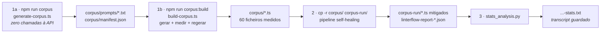

# 10 — Resultados do Experimento

Resultados da execução do pipeline LinterFlow sobre o corpus Zero-Shot de 60 ficheiros.
O protocolo está em [07 — Experimento](./07-experimento.md); este documento regista **o que
saiu dele** e como deve ser lido.

> **Execução:** 2026-08-17 (fase 2) · análise 2026-08-29 (fase 3)
> **Modelo:** `gemini-3.6-flash`, temperatura por omissão da API
> **Artefactos:** `corpus-run/linterflow-report-2026-08-17T14-53-54-419Z.{json,md,-stats.txt}`
> **Desvios e re-execuções:** [`corpus/DESVIOS.md`](../corpus/DESVIOS.md) §4

---

## 1. Como se chegou aos ficheiros analisados

A cadeia completa, do prompt ao número, em quatro passos. Cada um deixa um artefacto
versionado — a análise é reproduzível a partir do repositório sem repetir nenhuma chamada
à API.



### 1a — Desenho (sem API)

Desenho fatorial **5 tipos de componente × 3 tiers de CC × 4 réplicas = 60**. A complexidade
é induzida pelo **domínio de negócio**, nunca pedida explicitamente: um prompt de tier `high`
descreve um motor de aprovação de crédito com regras interdependentes, e não "escreve código
complexo". Nenhum prompt menciona qualidade, métricas, clean code ou design patterns — é
isso, e não o canal de envio, que constitui a condição Zero-Shot.

### 1b — Materialização e medição

Por ficheiro: gerar com `temperature = 0.9` → medir com o **mesmo `EvaluatorService`** que o
pipeline usa → se o CC cair fora da banda do tier, regerar com o **prompt inalterado**, até 5
tentativas. Nunca mitiga: não há `FeedbackService` nem `ProducerService` nesta fase, porque
aplicar critérios de qualidade na geração refactorizaria o corpus antes do tratamento e
destruiria a variável dependente.

Resultado: **55/60 dentro da banda pretendida**, média de 1,58 tentativas. Os 5 fora de banda
(todos `middleware_medium`) permanecem no experimento — "fora de banda" significa que o CC
medido não caiu no intervalo do tier, não que o ficheiro tenha sido descartado. As bandas
medidas não se sobrepõem (`low` 1–5 · `medium` 8–10 · `high` 18–150), que é a condição de que
o desenho fatorial depende.

### 2 — Mitigação

Pipeline sobre `corpus-run/`, uma **cópia** — o Producer escreve por cima do que refactoriza.
Até 5 iterações por ficheiro, gate em CC ≤ 10, MI ≥ 65, duplicação ≤ 3%.

**60/60 convergiram.** Só **27 ficheiros chamaram a API**; os outros 33 (todo o tier `low` e
13 do `medium`) passaram o gate à primeira medição, sem uma única chamada. Esse é o
**resultado de controlo**: o loop não toca em código que já está saudável. Dos 27 tratados, a
média foi de **1,41 iterações** (17 convergiram à primeira, 9 à segunda, 1 à terceira) — bem
abaixo do limite de 5.

### 3 — Análise

`scripts/stats_analysis.py` sobre o JSON do Reporter, com `--manifest` para a desagregação por
tier. Testes emparelhados pré/pós por ficheiro, α = 0,05:

| Teste | O que mede | Porquê este |
| --- | --- | --- |
| **Wilcoxon Signed-Rank** | Significância da diferença pré/pós | Não-paramétrico e emparelhado — métricas de código não são normais |
| **Cliff's Delta** | Tamanho do efeito | Não-paramétrico; interpretável em amostras pequenas |

Magnitudes de \|δ\| (Romano et al., 2006): < 0,147 negligible · < 0,33 small · < 0,474 medium
· ≥ 0,474 large.

> **O transcript é gravado em disco.** Cada execução escreve `<report>-stats.txt` ao lado do
> relatório analisado. Até 2026-08-29 o script só imprimia para stdout, e os números da
> dissertação existiam apenas em prosa — sem artefacto a que pudessem ser rastreados.
> `--no-save` suprime a gravação; `--out=` redirecciona.

---

## 2. Resultados globais (n = 60)

| Métrica | Pré | Pós | Δ | p | Cliff's δ | Veredicto |
|---|---|---|---|---|---|---|
| Violações de CC (funções acima do limiar) | 1,317 | 0,000 | **−1,317** | 0,00001 | −0,417 (medium) | melhoria |
| Max CC por função (o gate) | 24,050 | 6,800 | **−17,250** | 0,00001 | −0,292 (small) | melhoria |
| **CC total do ficheiro** | 60,750 | 63,083 | **+2,333** | **0,0167** | +0,022 (negligible) | **significativo mas pior** |
| **Pontos de decisão** (derivada) | 49,650 | 41,783 | **−7,867** | 0,00005 | −0,049 (negligible) | melhoria |
| Maintainability Index | 92,939 | 101,020 | **+8,081** | 0,00001 | +0,251 (small) | melhoria |
| Taxa de duplicação (%) | 0,340 | 0,034 | **−0,306** | 0,02506 | −0,087 (negligible) | melhoria |

Todas as violações de CC foram eliminadas: **0 funções acima do limiar em 60/60 ficheiros**.

### Por tier

O tier `low` não é uma falha do tratamento — é a ausência de tratamento. Nenhum dos 20
ficheiros violou um limiar, portanto o LLM nunca foi chamado e todas as diferenças são zero.
O Wilcoxon descarta diferenças nulas, pelo que o *n* efectivo do teste global é o número de
ficheiros efectivamente tratados, não 60.

| Métrica | `low` (n=20, 0 tratados) | `medium` (n=20, 7 tratados) | `high` (n=20, 20 tratados) |
|---|---|---|---|
| Violações de CC | 0,00 (sem alteração) | −0,30 · p=0,034 · δ=−0,250 (small) | **−3,65 · p=0,00008 · δ=−1,000 (large)** |
| Max CC por função | 0,00 (sem alteração) | −3,70 · p=0,017 · δ=−0,468 (medium) | **−48,05 · p=0,00009 · δ=−1,000 (large)** |
| CC total | 0,00 (sem alteração) | +1,05 · p=0,107 · n.s. | +5,95 · p=0,059 · n.s. |
| Pontos de decisão | 0,00 (sem alteração) | −1,30 · p=0,028 · δ=−0,107 | **−22,30 · p=0,00028 · δ=−0,338 (medium)** |
| Maintainability Index | 0,00 (sem alteração) | +5,52 · p=0,018 · δ=+0,372 (medium) | **+18,73 · p<0,00001 · δ=+0,790 (large)** |
| Duplicação | 0,00 (sem alteração) | −0,75 · p=0,109 · n.s. | −0,17 · p=0,138 · n.s. |

**δ = −1,000 no tier `high`** em violações e em max CC é separação perfeita: não existe um
único par pré/pós em que o ficheiro pós esteja pior que qualquer ficheiro pré. É o efeito
mais forte do experimento, e ocorre exactamente onde a dívida técnica era maior.

O efeito na **duplicação** não é significativo em nenhum tier isoladamente e é apenas
marginal no global (δ negligible). Há duas razões, e é preciso separá-las.

**Razão 1 — a medição do pipeline é por ficheiro.** O `analyzeFile()` chama
`detectDuplications(filePath)` com **um único caminho**
([producer.service.ts:124](../src/producer/producer.service.ts#L124)), pelo que o jscpd nunca
compara um ficheiro com outro. É deliberado — atribuir um clone de pasta a um ficheiro
individual falsearia o delta desse ficheiro (um erro corrigido durante o desenvolvimento) — mas torna a duplicação
**entre módulos** estruturalmente invisível. Verificado: dois services NestJS quase idênticos
dão **0 clones** medidos um a um e **1 clone** medidos como pasta.

**Razão 2 — o corpus tem mesmo pouca duplicação.** Medido ao nível do projecto com
`npm run dup` (que corre o jscpd sobre a pasta inteira), o corpus dá:

| | Pré (`corpus/`) | Pós (`corpus-run/`) | Δ |
|---|---|---|---|
| Linhas totais | 19 986 | 21 544 | +1 558 |
| Pares de clones | 8 | 3 | −5 |
| Linhas duplicadas | 168 | 60 | −108 |
| **Taxa de duplicação do projecto** | **0,841%** | **0,278%** | **−0,563** |

Continua baixa, e a maioria dos clones é **dentro do mesmo ficheiro**
(`repository_high_2.ts ↔ repository_high_2.ts`), não entre módulos. Isto confirma que o valor
próximo de zero não é só artefacto da medição: o desenho atribuiu um domínio de negócio
distinto a cada célula, precisamente para evitar quase-duplicados, e conseguiu-o. **Sessenta
ficheiros autocontidos sobre domínios diferentes não se repetem uns aos outros.**

> ⚠️ **Não reportar isto como mitigação de duplicação.** O pipeline nunca tentou reduzir esta
> duplicação — não a consegue ver. A descida de 0,841% para 0,278% é **efeito colateral** do
> refactoring de CC/MI. E as duas taxas não são intermutáveis: a do projecto conta os dois
> lados de cada par e faz união das linhas (uma linha em cinco clones conta uma vez), enquanto
> a por ficheiro soma fragmentos só do lado A. Ver o cabeçalho de
> [`scripts/project-duplication.ts`](../scripts/project-duplication.ts).

A `duplicationRate` continua, portanto, **sem dados que sustentem uma conclusão sobre
mitigação**. A fonte para isso é uma aplicação multi-módulo com recursos paralelos — ver a
mini rede social em [`corpus/DESVIOS.md`](../corpus/DESVIOS.md).

---

## 3. Complexidade total sob decomposição

Este é o resultado que a dissertação deve discutir, e é o único onde o veredicto automático
diz "pior".

### 3.1 O aparente paradoxo

A complexidade **por função** cai de forma acentuada e com efeito grande. A complexidade
**total do ficheiro** sobe, e a subida é estatisticamente significativa (p = 0,0167).

Em **20 dos 60 ficheiros** o pior método ficou dentro do limiar enquanto o total se manteve
ou subiu — 15 deles no tier `high`. O caso mais nítido:

| Ficheiro | Funções | CC total | Max CC por função |
|---|---|---|---|
| `service_high_4.ts` | 23 → **80** | 258 → 280 | **58 → 10** |
| `dto_high_1.ts` | 43 → **101** | 151 → 173 | **21 → 7** |
| `middleware_high_1.ts` | 10 → **39** | 136 → 165 | **86 → 10** |
| `service_high_3.ts` | 4 → **26** | 83 → 103 | **80 → 8** |
| `controller_high_2.ts` | 5 → **23** | 111 → 114 | **75 → 10** |

O padrão é inequívoco: **o número de funções quase duplica** (666 → 1278, +91,9% no corpus
inteiro) enquanto o CC total sobe pouco. Isto é **Extract Method** (Fowler, 1999) — o
refactoring canónico para reduzir complexidade por unidade — a ser aplicado em escala.

### 3.2 Porque é que o total sobe: é aritmética, não regressão

A subida do total não é um efeito colateral indesejado. É uma **propriedade da métrica**.

McCabe (1976) define a complexidade de um grafo de fluxo de controlo como
**v(G) = e − n + 2p**, onde *p* é o número de componentes ligados. Para um módulo com *p*
funções, a complexidade agregada inclui um termo **2p** — na prática, **cada função custa 1
antes sequer de ramificar**. O `EvaluatorService` calcula `totalCyclomaticComplexity` como a
soma do CC de todas as funções ([`evaluator.service.ts:90`](../src/evaluator/evaluator.service.ts#L90)),
pelo que herda exactamente essa propriedade.

Daí decorre um facto que resolve o paradoxo. Ao extrair um bloco da função `F` para uma nova
função `G`:

```
CC(G)         = 1 + d          (d = pontos de decisão que migraram)
CC(F) depois  = CC(F) − d      (a chamada a G não é um ponto de decisão)
────────────────────────────────────────────────────────────────────
soma depois   = CC(F) + 1
```

**Cada extracção adiciona exactamente +1 ao total, mesmo que nenhuma ramificação seja
criada.** O CC total é, por construção, incapaz de distinguir "mais ramificação" de "a mesma
ramificação, distribuída por mais funções".

### 3.3 O orçamento da decomposição

Descontando esse custo estrutural, a leitura inverte-se:

| | `low` | `medium` | `high` | **Total** |
|---|---|---|---|---|
| Ficheiros tratados | 0 | 7 | 20 | **27** |
| Funções | 123 → 123 | 153 → 200 | 390 → 955 | **666 → 1278 (+612)** |
| CC total | 181 → 181 | 608 → 629 | 2856 → 2975 | **3645 → 3785 (+140)** |
| Custo estrutural (+1 por função nova) | 0 | +47 | +565 | **+612** |
| Subida observada | 0 | +21 | +119 | **+140** |
| **Redução estimada de pontos de decisão** | 0 | **26** | **446** | **472** |

Se o Extract Method fosse pura relocalização, o total teria subido **+612**. Subiu **+140**.
A diferença — **472 pontos de decisão, −15,8%** — é ramificação que desapareceu: guardas
redundantes, condições consolidadas, ramos mortos.

Isto motiva a métrica derivada **pontos de decisão = CC total − nº de funções**, que cancela
o termo estrutural e isola a ramificação. Ela **cai de forma significativa** globalmente
(−7,87, p = 0,00005) e no tier `high` (−22,30, p = 0,00028, δ = −0,338 *medium*).

> **Leitura:** a subida do CC total não indica, por si só, que o pipeline aumentou a
> complexidade. O pipeline decompôs funções monolíticas em funções pequenas — pagando o custo
> aritmético fixo dessa decomposição — e o número de pontos de decisão caiu cerca de 15,8%
> (efeito negligenciável no global, médio no tier `high`). O "significativo mas pior" do CC
> total explica-se em grande parte por uma métrica aditiva sob decomposição.

### 3.4 Porque é que isto é uma melhoria de legibilidade

O ganho de legibilidade não se infere do CC total; infere-se das outras métricas e da
literatura.

- **O MI corrobora.** O Maintainability Index sobe +8,08 globalmente e **+18,73 no tier
  `high` com δ = +0,790 (large)** — precisamente nos ficheiros onde a decomposição foi mais
  agressiva. Se a fragmentação tivesse degradado o código, o MI teria caído com ela. Subiu.

- **O argumento de Fowler.** *Extract Method* justifica-se por nomear intenção: um bloco de
  código que precisa de um comentário para ser compreendido deve tornar-se uma função cujo
  nome substitui esse comentário. O critério não é o comprimento, é a distância semântica
  entre o que o código faz e o que o leitor precisa de saber. Uma função de CC 58 obriga a
  reconstruir mentalmente 58 caminhos de execução; 8 funções de CC 7, com nomes de domínio,
  são lidas uma de cada vez.

- **A unidade de leitura é a função, não o ficheiro.** Ninguém lê 280 pontos de decisão de
  uma vez. Lê-se o método que se está a alterar. É por isso que o limiar de CC ≤ 10 é
  definido por função — e é essa unidade, a única que o programador realmente enfrenta, que
  melhorou com separação perfeita (δ = −1,000) no tier `high`.

### 3.5 O achado só existe por causa de duas métricas

Com as três métricas originais (max CC, MI, duplicação), o relatório teria dito
*"max CC −17,25, p < 0,001, melhoria significativa"* e nada mais. A redistribuição seria
invisível, e a dissertação teria reportado uma vitória sem qualificação.

`totalCyclomaticComplexity` e `functionCount` foram acrescentados ao `FileMetrics`
precisamente para tornar essa distinção observável. **Uma métrica que só consegue confirmar
a hipótese não a está a testar.**

Isto corrobora Blyth et al. (SCAM 2025), que reportam `R0912` (*too-many-branches*) entre os
poucos problemas que **pioraram** após refactoring guiado por análise estática — o mesmo
mecanismo, observado noutro pipeline.

> ⚠️ **Limitação a declarar na dissertação.** A contabilidade de +1 por função é um **modelo
> da decomposição, não uma auditoria de refactorings**. O LLM reescreve o ficheiro inteiro,
> não aplica um Extract Method rastreável: funções podem ser criadas ou removidas por outras
> razões, e a diferença de 472 é uma estimativa agregada, não uma contagem de ramos
> eliminados um a um. O que a métrica sustenta com solidez é a direcção — a ramificação caiu
> enquanto o número de funções subiu — e não o valor exacto.

---

## 4. Onde estão os artefactos

| Artefacto | Caminho | Regenerável? |
|---|---|---|
| Prompts Zero-Shot (60) | `corpus/prompts/*.prompt.txt` | Sim — `npm run corpus` |
| Corpus medido (plano + métricas) | `corpus/manifest.json` | Não sem repetir a API |
| Corpus original (60 `.ts`) | `corpus/*.ts` | Não sem repetir a API |
| Código mitigado (60 `.ts`) | `corpus-run/*.ts` | Não sem repetir a API |
| Relatório do Reporter | `corpus-run/linterflow-report-*.json` / `.md` | Não |
| **Transcript da análise** | `corpus-run/linterflow-report-*-stats.txt` | **Sim** — determinístico |
| **Duplicação ao nível do projecto** | `corpus-run/project-duplication-corpus.json` | **Sim** — `npm run dup -- --before=corpus --after=corpus-run` |
| Re-execução de 5 ficheiros | `corpus-retry/` (+ relatório e transcript próprios) | Não |
| Desvios e ameaças à validade | `corpus/DESVIOS.md` | Não — registo manual |

A análise estatística é **determinística**: reproduz-se a partir do JSON versionado, sem
nenhuma chamada à API.

```bash
python3 scripts/stats_analysis.py \
  corpus-run/linterflow-report-2026-08-17T14-53-54-419Z.json \
  --manifest=corpus/manifest.json
```

> ⚠️ `corpus/` é o corpus original e **nunca** deve ser o alvo do pipeline: o Producer
> escreve por cima do que refactoriza. E nunca duas vezes sobre a mesma pasta — na segunda
> execução o snapshot "pré" seria código já refactorizado.

---

## 5. Ameaças à validade

| Ameaça | Mitigação | Estado |
|---|---|---|
| Prompts induzirem qualidade (quebra do Zero-Shot) | Prompts nunca mencionam métricas ou padrões; complexidade só pelo domínio | Mitigada no desenho |
| Quase-duplicados dentro de uma célula | 4 domínios distintos por célula (20 por tier) | Mitigada — mas reduz o sinal de duplicação (§2) |
| Ficheiros fora da banda do tier | Regeneração com o mesmo prompt; desvios registados | **5/60 fora de banda**, todos `middleware_medium` |
| Regeneração até cair em banda ser selecção | `attempts` registado por ficheiro no manifest | Declarada, não eliminada |
| Não-convergência mascarar regressões | Ficheiros não convergidos são restaurados ⇒ Δ = 0 | Não aplicável — 60/60 convergiram |
| Distribuições não-normais | Wilcoxon + Cliff's δ | Mitigada |
| CC total interpretado como regressão | Métrica derivada de pontos de decisão + orçamento (§3.3) | **Analisada, com a limitação de §3.5 declarada** |
| Recuperação de 5 ficheiros após falha de rede | `corpus/DESVIOS.md` §4 — 60/60 depende dela; sem ela seria 55/60 | Declarada |
| Duplicação entre módulos invisível ao pipeline | Medição ao nível do projecto, à parte (`npm run dup`) | **Medida, não mitigada** — o pipeline não a consegue ver, logo não a pode tratar |
| Um único modelo (`gemini-3.6-flash`) | — | **Não mitigada** — os resultados não se generalizam a outros LLMs |

---

## 5b. Braço de controlo — comparação com um prompt genérico

O desenho pré/pós de §2 mostra que o ciclo melhora o código. Não mostra que a **análise
estática** foi o que o conseguiu, porque detectar, apontar, reescrever e iterar foram sempre
aplicados em conjunto. Pedir refactoring a um LLM não é contribuição desta dissertação;
orientá-lo com o output da análise estática é. O braço de controlo separa as duas coisas em parte: não itera, por isso não distingue o efeito do *targeting* do efeito da repetição.

> **Execução:** 2026-09-06 · 60 ficheiros · 0 falhas
> **Artefactos:** `corpus-baseline/*.ts`, `baseline-report.json`, `arm-comparison.txt`

### 5b.1 O que distingue os dois braços — e só isto

| | Braço A (guiado) | Braço B (controlo) |
|---|---|---|
| Papel, caminho do ficheiro | idêntico | idêntico |
| **Bloco do analisador** (funções infractoras com o CC, valor do MI, taxa de duplicação) | **presente** | **ausente** |
| Tarefa | *"resolve these specific issues"* | *"improve its quality"* |
| Constraints 1–3 (lógica, contrato público, só código) | idênticas | idênticas |
| Modelo, montagem do prompt, retry, parsing, Evaluator | idênticos | idênticos |
| Iterações | até 5, com re-medição | 1 |

**As constraints ficam nos dois de propósito.** Retirá-las moveria quatro variáveis ao mesmo
tempo: sem a 2ª o modelo pode apagar exports — o que baixa o CC por apagar código e faria o
controlo parecer *melhor* por uma razão absurda; sem a 3ª devolve Markdown e uma falha de
parsing contaria como falha de refactoring. Um controlo tem de igualar o tratamento em tudo
excepto nos achados da análise estática.

**A iteração é o confundimento assumido.** O braço B não pode iterar: sem medição não há
critério de paragem. A linha de esforço igualado em §5b.2 é o análogo mais próximo.

### 5b.2 O resultado principal

Nos **27 ficheiros que violavam o gate**:

| | Passam a cumprir |
|---|---|
| **Guiado (até 5 iterações)** | **27/27 — 100%** |
| Ingénuo (1 passagem) | **6/27 — 22%** |

E a esforço igualado, uma passagem cada — **17 dos 27 guiados convergiram logo à primeira**:

| | Passam a cumprir |
|---|---|
| **Guiado, 1.ª passagem** | **17/27 — 63%** |
| Ingénuo, 1 passagem | 6/27 — 22% |

**A vantagem não vem de iterar mais: vem de saber que funções atacar.**

### 5b.3 Testes emparelhados — mesmo ficheiro, dois tratamentos

Δ do braço guiado contra Δ do braço ingénuo, nos 27 ficheiros, α = 0,05:

| Métrica | Δ guiado | Δ ingénuo | p | Cliff's δ | Veredicto |
|---|---|---|---|---|---|
| Violações de CC | **−2,926** | **+0,259** | 0,00006 | 0,798 (large) | **guiado** |
| Max CC por função | −38,333 | −30,185 | 0,00003 | 0,151 (small) | guiado |
| CC total | +5,185 | −0,296 | 0,0495 | 0,274 (small) | *ingénuo* ⚠️ |
| **Pontos de decisão** | **−17,481** | −9,370 | 0,00524 | 0,294 (small) | **guiado** |
| Nº de funções | +22,667 | +9,074 | 0,00006 | 0,617 (large) | *ingénuo* ⚠️ |
| Maintainability Index | +17,958 | +11,950 | 0,00005 | 0,380 (medium) | guiado |
| Duplicação (%) | −0,680 | −0,645 | 1,000 | 0,000 | sem diferença |

**O prompt ingénuo, em média, piorou as violações de CC (+0,259).** Melhora o MI de forma
apreciável — arruma, reestrutura, dá nomes melhores — mas não reduz a complexidade por função,
porque não sabe onde ela está.

> ⚠️ **As duas linhas marcadas são consistentes com a contabilidade de §3.** O braço guiado cria **22,7 funções novas por ficheiro** contra 9,1 do ingénuo, e McCabe
> cobra 1 por função antes de ramificar — logo o seu CC total sobe por construção. Na
> ramificação em si, medida pelos pontos de decisão, o guiado remove **17,5 contra 9,4**, quase
> o dobro. O nº de funções está na tabela precisamente para a aritmética ficar visível em vez de
> afirmada.

### 5b.4 Duas expectativas que os dados desmentiram

**O prompt ingénuo não degradou código saudável.** Refactorizou os 33 ficheiros que já cumpriam
o gate e **os 33 continuam a cumprir** — zero quebrados, zero exports apagados, zero devolvidos
inalterados. A hipótese de que o gate protege contra estragos **não se sustenta**. O valor do
gate é outro, e mais modesto: poupa 33 chamadas à API e deixa intacto o que não precisa de ser
tocado. Reportar assim.

**Na compilação, o braço guiado fica marginalmente pior:**

| | Falham a compilar |
|---|---|
| `corpus/` (pré) | 3/60 |
| `corpus-run/` (guiado) | **4/60** — partiu `controller_high_4` |
| `corpus-baseline/` (ingénuo) | **3/60** — partiu `controller_high_4`, corrigiu `repository_high_3` |

Com estes números está tudo dentro do ruído, mas **nenhum braço ganha aqui**, e o guiado
introduziu uma regressão que o ingénuo compensou com uma correcção. É o contraponto honesto ao
27/27 contra 6/27, e deve aparecer ao lado dele, não numa nota de rodapé.

### 5b.5 O que este braço sustenta, e o que não

**Sustenta:** a orientação por análise estática — nomear as funções infractoras e o seu CC — é
o que produz a redução de complexidade. Sem ela, o mesmo modelo, com o mesmo prompt em tudo o
resto, resolve menos de um quarto dos casos e piora ligeiramente as violações.

**Não sustenta:** que o ciclo iterativo contribua para além da primeira passagem (o controlo
não itera); que o gate previna estragos (§5b.4); nem que o resultado se generalize a outros
modelos.

Reproduzir:

```bash
npm run baseline                              # 60 chamadas, retoma se interrompido
npx ts-node scripts/compare-arms.ts           # só de leitura sobre os corpora
```

---

## 6. Estudo de caso — a mini rede social

Segundo corpus: uma aplicação produzida por um pedido único em linguagem corrente, sem
especificação (ver [07 §Segundo corpus](./07-experimento.md)). **n = 1 aplicação, 31
ficheiros.** Descritivo — não entra em nenhum teste estatístico com os 60.

> **Execução:** 2026-09-04 · Gerada com Antigravity (Gemini) · 1535 linhas
> **Artefactos:** `manual-corpus-run/linterflow-report-*.json`, `project-duplication-app.json`

### 6.1 Resultado da mitigação

**31/31 convergiram. Dois ficheiros foram tratados, ambos exclusivamente por duplicação.**

| Ficheiro | Iterações | DR | MI | Funções |
|---|---|---|---|---|
| `src/posts/posts.service.ts` | 1 | 7,91% → **0%** | 96,4 → **102,2** | 9 → 11 |
| `src/feed/feed.service.ts` | 1 | 28,17% → **0%** | 108,6 → 111,9 | 6 → 6 |

Ao nível do projecto: **4,104% → 0%**, ambos os pares de clones eliminados, 1535 → 1523 linhas.

> **Esta é mitigação genuína, não efeito colateral.** A ressalva de §2 — o pipeline não vê
> duplicação e qualquer movimento seria incidental — aplica-se a clones **entre** ficheiros.
> Estes eram **dentro** de um único ficheiro, que é precisamente o que o gate por ficheiro vê.
> O loop atacou-os deliberadamente, e a `duplicationRate` tem finalmente um resultado por trás.

### 6.2 O achado: a distribuição de complexidade não se parece com a do corpus

Vinte e nove dos 31 ficheiros passaram o gate sem tratamento. A razão é estrutural:

| | Corpus de 60 | Esta aplicação |
|---|---|---|
| low (CC ≤ 5) | 33,3% | **96,8%** |
| medium (6–10) | 25,0% | 3,2% |
| high (> 10) | 41,7% | **0%** |
| Máximo de CC observado | 150 | **10** |
| Linhas por ficheiro (média) | 333 | **50** |
| Funções por ficheiro (média) | 11,1 | **2,4** |
| Ficheiros com MI < 65 | — | **0** (mínimo 68,4) |

E não é uma questão de calibração dos limiares: **27 dos 31 ficheiros têm CC entre 1 e 3**, e
**28 têm MI acima de 95**. Não falharam o gate por pouco — estão muito longe dele.

**A causa está nos prompts do corpus.** Pedem *"a single, self-contained TypeScript file"*, e é
essa restrição que fabrica a complexidade, ao forçar todas as regras de um domínio para dentro
de um só módulo. Com liberdade arquitectural, o mesmo modelo espalhou lógica equivalente por 31
ficheiros pequenos e nunca cruzou um limiar de CC ou MI.

### 6.3 Então a framework traz melhorias?

A pergunta que estes dados obrigam a fazer. A resposta honesta tem duas partes.

**Quando dispara, funciona.** 27/27 ficheiros tratados no corpus e 2/2 aqui convergiram —
100% de convergência nos dois corpora. A eficácia não está em causa.

**O que está em causa é a frequência com que é preciso.** Em código de aplicação *greenfield*
gerado por um modelo actual, com os limiares convencionais (CC ≤ 10, MI ≥ 65), quase nunca.
Aqui foram 2 ficheiros em 31, e nenhum por complexidade.

Duas leituras que não se anulam:

1. **Qualifica os resultados do corpus.** Os efeitos grandes no tier `high` (δ = −1,000) são
   reais, mas foram medidos numa banda de complexidade que a aplicação de um utilizador leigo
   **não ocupa**. A generalização "a framework reduz dívida técnica em código gerado por LLM"
   tem de ser restringida a código que tenha essa dívida.

2. **É um resultado positivo sobre os modelos actuais.** A decomposição que o pipeline teve de
   **forçar** no corpus (666 → 1278 funções, §3) o agente executa **espontaneamente** quando não
   está preso a um ficheiro único. Mesmo estado final, caminho diferente.

**Os 29 ficheiros intocados são o resultado de controlo, não uma falha.** Uma ferramenta que
alterasse código saudável seria pior, não melhor — e é o mesmo comportamento do tier `low` do
corpus, onde os 20 ficheiros deram diferença zero em tudo.

**A duplicação é a excepção, e é a mais interessante.** Foi a única categoria em que o modelo
produziu dívida real — 28% num ficheiro — e é precisamente a que o corpus sintético não
conseguia testar, por ter um domínio distinto em cada ficheiro. Um modelo actual decompõe bem
e repete-se na mesma.

### 6.4 O que este corpus não testou

O alcance da conclusão de §6.3 é estreito, e convém dizê-lo antes que alguém o diga:

| Não coberto | Porquê importa |
|---|---|
| Código acumulado ao longo de várias sessões | Uma sessão única mantém coerência que sessões sucessivas perdem |
| Bases de código grandes | 1535 linhas; a dívida estrutural tende a aparecer com a escala |
| Código legado ou de manutenção | Só *greenfield* foi testado |
| Modelos mais antigos ou mais fracos | Um único modelo, um único pedido |
| Limiares mais exigentes | CC ≤ 10 e MI ≥ 65 são convenções, não constantes físicas |

E, sobretudo: **n = 1**. Uma segunda execução do mesmo pedido construiria outra aplicação. Isto
sustenta uma observação, não uma inferência.

### 6.5 Um defeito do instrumento, encontrado pelo corpus realista

Doze dos 31 ficheiros — todos os services e controllers — rebentavam o `EvaluatorService` com
`state.generator[node.type] is not a function`, e o erro abortava a análise da pasta inteira.

A causa: `constructor(private readonly x: T)`, o *parameter property* do TypeScript. É como
todo o NestJS declara dependências, e produz um nó `TSParameterProperty` que o gerador de código
do escomplex desconhece.

**Nenhum dos 60 ficheiros do corpus o expôs**, porque os prompts pediam ficheiros
*self-contained* — e um ficheiro self-contained não injecta nada. O instrumento não conseguia
medir código NestJS comum e ninguém tinha reparado.

Corrigido desembrulhando o nó antes da análise; verificado que **os 60 ficheiros do corpus
produzem métricas idênticas às do manifest**, pelo que os resultados anteriores continuam
comparáveis. É o argumento de validade externa deste corpus a materializar-se — como falha do
instrumento, não como resultado.

---

## Ver também

- [07 — Experimento](./07-experimento.md) — protocolo, fases e comandos
- [`corpus/DESVIOS.md`](../corpus/DESVIOS.md) — desvios entre o corpus desenhado e o materializado
- [`corpus/FLUXO-GERACAO.md`](../corpus/FLUXO-GERACAO.md) — comparação das vias de geração
- [04 — Módulos](./04-modulos.md) — como o Evaluator calcula cada métrica
