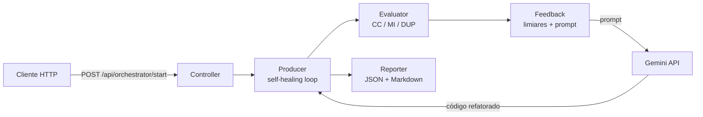

# LinterFlow — Documentação Técnica

Documentação completa do sistema **LinterFlow**, o pipeline self-healing de análise estática + LLM desenvolvido no âmbito da dissertação *Analysis and Automated Structural Refactoring of LLM-Generated Code in Web Application Development* (MEECPI, ISEP, 2026).

Todos os diagramas usam [Mermaid](https://mermaid.js.org/) e são renderizados nativamente no GitHub, VS Code (com a extensão Markdown Preview Mermaid) e na maioria dos visualizadores Markdown.

## Índice

| Documento | Conteúdo |
| --- | --- |
| [01 — Visão Geral](./01-visao-geral.md) | O problema, a solução, contexto do sistema e stack tecnológica |
| [02 — Arquitetura](./02-arquitetura.md) | Diagramas de componentes, dependências entre módulos NestJS, visão C4 |
| [03 — Fluxo do Pipeline](./03-fluxo-pipeline.md) | Fluxograma do self-healing loop, diagrama de sequência e máquina de estados |
| [04 — Módulos](./04-modulos.md) | Detalhe de cada módulo: Producer, Evaluator, Feedback, Reporter, Core |
| [05 — API REST](./05-api.md) | Endpoints, DTOs, validação, Swagger, exemplos de request/response |
| [06 — Modelo de Dados](./06-modelo-dados.md) | Diagrama de classes dos tipos partilhados e do relatório de mitigação |
| [07 — Experimento](./07-experimento.md) | Corpus Zero-Shot (60 ficheiros), protocolo experimental e análise estatística |
| [08 — Decisões de Arquitetura](./08-decisoes-arquiteturais.md) | ADRs: limiares de qualidade, escolhas de ferramentas, trade-offs |
| [09 — Autenticação e Créditos](./09-autenticacao-creditos.md) | Contas, JWT, papéis, painel de administração e faturação por créditos — inclui como desativar ou remover o sistema de créditos |
| [10 — Resultados](./10-resultados.md) | Resultados do experimento: Wilcoxon + Cliff's δ por métrica e por tier, o braço de controlo (27/27 vs 6/27) e a complexidade total sob decomposição (Extract Method) |

## Resumo do sistema em 30 segundos

O LinterFlow recebe um diretório com código TypeScript (tipicamente gerado por LLM), mede a qualidade de cada ficheiro com análise estática (Complexidade Ciclomática, Índice de Manutenibilidade, taxa de duplicação), e quando um ficheiro viola os limiares, gera um prompt de refactoring e pede ao Gemini que reescreva o código. O ciclo repete-se até o ficheiro passar nos limiares ou atingir 5 iterações. No fim, um relatório agrega as métricas pré/pós e os deltas por ficheiro.

## Limiares de qualidade

| Métrica | Limiar | Referência |
| --- | --- | --- |
| Complexidade Ciclomática (CC) | ≤ 10 | McCabe, 1976 |
| Índice de Manutenibilidade (MI) | ≥ 65 | Oman, 1992 |
| Taxa de duplicação | ≤ 3% | jscpd |
| Iterações máximas do loop | 5 | — |
